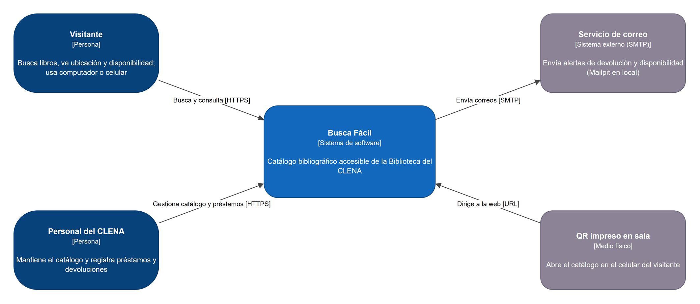
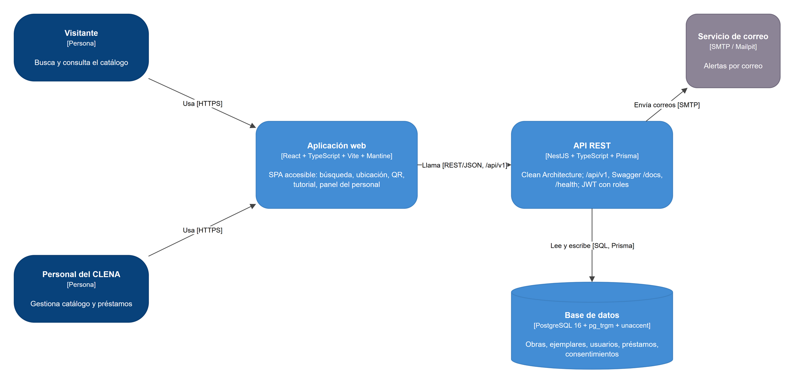
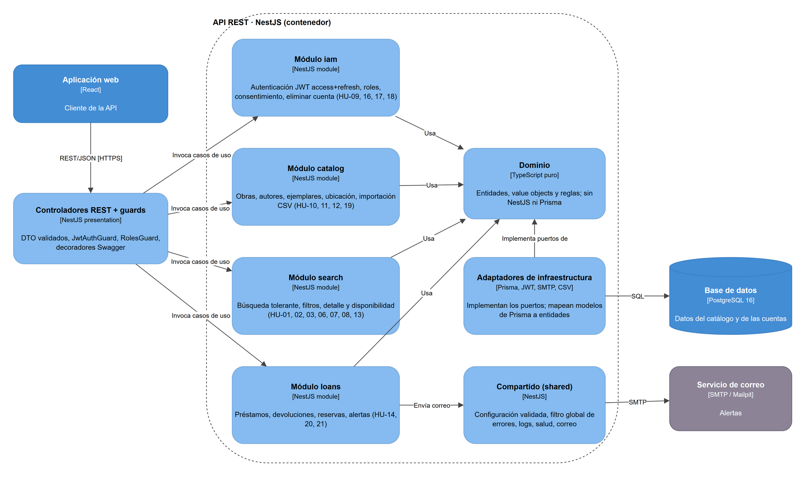

# Arquitectura

> Responsable: Rafael Potes · Revisa: Humberto Llinás · Work item: CLENA-29 (T-08)

## 1. Contexto

El sistema permite que los visitantes de la Biblioteca del CLENA busquen material, vean su ubicación física y su disponibilidad, y completen un tutorial guiado en su primera búsqueda. El personal mantiene el catálogo y registra préstamos y devoluciones.


### Nivel 1 · Contexto



Dos tipos de personas usan el sistema: el visitante, que busca y consulta, y el personal del CLENA, que mantiene el catálogo y los préstamos. El único sistema externo es el servicio de correo para las alertas. El QR impreso en sala solo abre la web.

### Nivel 2 · Contenedores



| Contenedor | Tecnología | Responsabilidad |
|---|---|---|
| Aplicación web | React + TypeScript + Vite + Mantine | Interfaz accesible; consume la API REST |
| API REST | NestJS + TypeScript + Prisma | Reglas de negocio, autenticación JWT y roles, correo |
| Base de datos | PostgreSQL 16 + `pg_trgm` + `unaccent` | Persistencia y búsqueda tolerante |

### Nivel 3 · Componentes de la API



Los controladores solo invocan casos de uso de los módulos (`iam`, `catalog`, `search`, `loans`). Los módulos dependen del dominio y nunca al revés; la infraestructura implementa los puertos que el dominio y la aplicación declaran. La sección 4 detalla las capas.

## 2. Stack

| Componente | Tecnología | Motivo |
|---|---|---|
| Backend | NestJS + TypeScript | Exigido por el enunciado; inyección de dependencias que facilita Clean Architecture |
| ORM | Prisma | Tipado fuerte y migraciones versionadas (ADR-01) |
| Base de datos | PostgreSQL 16 + `pg_trgm` + `unaccent` | Exigido (≥ 15); búsqueda tolerante sin servicios extra (ADR-02) |
| Frontend | React + TypeScript + Vite + Mantine | Exigido React + TS; Mantine ofrece componentes accesibles (ADR-04) |
| Contenedores | Docker + docker-compose | Exigido; mismo entorno para todos |
| CI | GitHub Actions | Exigido |
| Despliegue | Google Cloud Run + Neon con URL fija (opción B, la de la entrega); túnel rápido de Cloudflare desde un equipo propio como respaldo (opción A) | Sin costo para el equipo (créditos de Google Cloud y plan gratuito de Neon); el modelo de embeddings necesita unos 2 GB de RAM (ADR-05, `docs/despliegue.md`) |

## 3. Módulos

Cada módulo es un contexto del negocio con sus propias capas.

| Módulo | Responsabilidad | Historias |
|---|---|---|
| `iam` | Usuarios, roles, autenticación JWT y comando para crear el primer administrador (HU-09, integrado). Cuenta de lector con consentimiento, eliminación de cuenta y gestión de cuentas del personal (HU-16, HU-17, HU-18) no se terminaron | HU-09, HU-16, HU-17, HU-18 |
| `catalog` | Obras, autores, temas, ejemplares, ubicaciones e importación CSV idempotente con ISBN validado (HU-10 y HU-12, integrados). La edición de ubicación y estado y el alta de ejemplares aparte (HU-11, HU-19) no se terminaron | HU-10, HU-11, HU-12, HU-19 |
| `search` | Búsqueda híbrida (léxica y semántica), filtros, detalle público, disponibilidad (HU-01, 02, 03, 06 y 08, integrados). La búsqueda por voz (HU-13) no se terminó | HU-01, HU-02, HU-03, HU-06, HU-07, HU-08, HU-13 |
| `loans` | Préstamos y devoluciones registrados por el personal (HU-20, integrado en `main`). Reservas y alertas (HU-14, HU-21) no se terminaron | HU-14, HU-20, HU-21 |
| Frontend transversal | Accesibilidad, QR, tutorial | HU-04, HU-05, HU-15 |
| `shared` | Configuración, errores, logs, Prisma, salud, correo | Transversal |

## 4. Capas y regla de dependencia

| Capa | Depende de | Contiene |
|---|---|---|
| `presentation` | `application` | Controladores, DTO, guards |
| `infrastructure` | `application`, `domain` | Prisma, JWT, SMTP, CSV |
| `application` | `domain` | Casos de uso y puertos |
| `domain` | nada | Entidades, value objects y reglas |

Las dependencias apuntan siempre hacia el dominio.

- **domain**: TypeScript puro. Entidades (`Work`, `Copy`, `Loan`…), value objects (`Isbn`, `ShelfLocation`, `Email`), reglas y errores de dominio. Prohibido importar `@nestjs/*`, `@prisma/*` o librerías externas. Una regla de ESLint lo verifica en CI.
- **application**: casos de uso (`SearchWorks`, `RegisterLoan`, `ImportCatalog`…) y **puertos**: interfaces que el caso de uso necesita (`WorkRepository`, `Mailer`, `Clock`, `PasswordHasher`). No conoce HTTP ni Prisma.
- **infrastructure**: adaptadores que implementan los puertos (`PrismaWorkRepository`, `SmtpMailer`, `JwtTokenService`). Los modelos de Prisma se mapean a entidades y no salen de esta capa.
- **presentation**: controladores REST, DTO con `class-validator`, guards y decoradores de Swagger. Solo llaman casos de uso.

Los puertos se registran en el módulo de NestJS con tokens:

```ts
// catalog.module.ts
providers: [
  RegisterWork,
  { provide: WORK_REPOSITORY, useClass: PrismaWorkRepository },
]
```

### Estructura de carpetas

```text
backend/src/
  modules/
    catalog/
      domain/          work.entity.ts, copy.entity.ts, shelf-location.vo.ts
      application/     register-work.use-case.ts, ports/work.repository.ts
      infrastructure/  prisma-work.repository.ts, csv/
      presentation/    works.controller.ts, dto/
      catalog.module.ts
    iam/ search/ loans/
  shared/              config/, errors/, logging/, prisma/, health/, mail/
frontend/src/
  app/ (rutas y layouts)  features/ (search, catalog, loans, auth)  shared/ (api, theme, ui)
```

## 5. Flujo de una petición

Ejemplo: el personal registra un préstamo.

1. `POST /api/v1/loans` llega a `LoansController`. `JwtAuthGuard` valida el access token y `RolesGuard` exige STAFF o ADMIN.
2. `ValidationPipe` valida el DTO (`copyId`, `readerId`).
3. El controlador llama `RegisterLoan.execute()`.
4. El caso de uso carga el ejemplar y el lector por sus puertos. La entidad `Copy` aplica la regla «solo se presta si está Disponible» y `Loan` calcula la fecha de devolución con el `Clock` inyectado.
5. El repositorio guarda préstamo y estado del ejemplar en una transacción. Un índice único parcial (un préstamo activo por ejemplar) evita dos préstamos simultáneos.
6. Un error de dominio (`CopyNotAvailableError`) se traduce en el filtro global a `409` con el formato uniforme.

## 6. API

- Prefijo `/api/v1`. Documentación Swagger en `/docs` (el enunciado la pide ahí). Salud en `/api/v1/health` (incluye chequeo de base de datos), con alias `/health` sin prefijo que pide la Entrega 1. El healthcheck de Docker usa `/api/v1/health`.
- `/api/v1/health` añade `semanticModel` (`off|loading|ready|error`): solo informa el estado del modelo de embeddings local; un modelo caído no cambia `status`. El modelo (multilingual-e5-small q8) se descarga en la etapa `model` del Dockerfile con revisión fijada y SHA-256, se copia a `/app/models` y se carga sin red ni caché escribible (`allowRemoteModels = false`); se inicia en segundo plano al arrancar con `SEMANTIC_SEARCH=on` y `EMBEDDING_PROVIDER=local`.
- Formato de error único:

```json
{ "statusCode": 409, "error": "Conflict", "message": "El ejemplar ya está prestado", "path": "/api/v1/loans", "timestamp": "2026-11-12T15:04:05.000Z" }
```

- Paginación: `?page=1&pageSize=10`; respuesta `{ data, meta: { page, pageSize, total } }`.

## 7. Seguridad

| Tema | Decisión |
|---|---|
| Autenticación | Access token JWT de 15 min en memoria del frontend; refresh token de 7 días en cookie `httpOnly`, `Secure`, `SameSite=Strict` (ADR-03) |
| Rotación | Cada refresh emite uno nuevo y revoca el anterior. Reutilizar uno revocado invalida la familia completa |
| Roles | `ADMIN` (todo, usuarios, importación, analítica), `STAFF` (catálogo, préstamos, ayuda), `READER` (su cuenta y préstamos) |
| Contraseñas | argon2 (o bcrypt de costo 12) |
| Abuso | Bloqueo de cuenta de 15 minutos tras 5 intentos fallidos (contador atómico en la base de datos; durante el bloqueo responde el mismo 401 genérico que una contraseña incorrecta, sin 429 ni `Retry-After`), verificación de un hash ficticio cuando el correo no existe para que el tiempo de respuesta no lo revele, y límite por IP con `@nestjs/throttler`: 300 peticiones/min global y 20/min en `/auth/*` (configurable con `THROTTLE_*`); el health check queda excluido. Tras un proxy inverso se activa `TRUST_PROXY` para usar la IP real |
| Cabeceras | Helmet con CSP `default-src 'none'` y `frame-ancestors 'none'`, HSTS, `nosniff` y sin `X-Powered-By`; CSP relajada solo en `/docs`. CORS solo para los orígenes de `CORS_ORIGIN` (sin `*`). Cuerpo JSON limitado a 2 MB. Swagger deshabilitado en producción |
| Cadena de suministro | Dependabot semanal (npm y GitHub Actions) y análisis CodeQL en cada PR, en `main` y cada semana |
| Datos personales | Ley 1581 de 2012: aviso, consentimiento registrado con versión, datos mínimos, exportar y eliminar cuenta. Las búsquedas se registran sin datos personales |
| Secretos | Solo en variables de entorno; `.env` fuera del repositorio |
| Escaneo en CI | `.github/workflows/seguridad.yml` (PR, push a `main` y cada lunes). **gitleaks** recorre todo el historial de git y falla con cualquier secreto (salida redactada). **Trivy** revisa los lockfiles de pnpm, la configuración de los Dockerfiles (HIGH y CRITICAL) y las dos imágenes de producción construidas en el job; falla con vulnerabilidades CRITICAL que ya tengan arreglo (`--ignore-unfixed`). El informe completo (HIGH y CRITICAL) se sube como SARIF a la pestaña Security y se resume en cada ejecución. Los hallazgos sin arreglo se aceptan por escrito en el informe de seguridad |

## 8. Búsqueda

Búsqueda actual (léxica):

1. Normaliza el texto: minúsculas, sin tildes (`unaccent`), espacios simples.
2. Combina coincidencia parcial (`ILIKE`) y similitud de trigramas (`similarity`, operador `%`) sobre título, autores y temas.
3. Ordena por puntuación: coincidencia exacta > parcial > similar.
4. Índices GIN `gin_trgm_ops` sobre columnas normalizadas generadas.

Meta: < 1 s con 5 000 obras.

Búsqueda híbrida (ADR-08): `GET /search/works` acepta `mode=hybrid|lexical|semantic`; por defecto es `hybrid` si `SEMANTIC_SEARCH=on` y `lexical` si no. `SearchWorks` toma hasta 100 candidatos léxicos y 100 vectoriales (distancia coseno exacta en pgvector, con los mismos filtros), descarta los vectoriales poco cercanos (`SEARCH_MIN_SIMILARITY` y `SEARCH_RELATIVE_CUTOFF`; una obra solo semántica bajo el umbral no entra), los fusiona con `fuseRrf` (Reciprocal Rank Fusion, k = 60, con la léxica ponderada por `SEARCH_LEXICAL_WEIGHT`) y pagina sobre la lista fusionada; por eso en `hybrid` y `semantic` `meta.total` queda acotado a 200 y 100 y cuenta solo lo que se devuelve. Cada obra lleva `matchSource` (`lexical`, `semantic` o `both`). La respuesta añade `meta.mode` (modo aplicado) y `meta.degraded`. Si el generador falla, no está listo, tarda más de `SEMANTIC_TIMEOUT_MS` o ya hay `SEMANTIC_MAX_CONCURRENCY` inferencias en curso, responde solo la léxica con `degraded = true`, nunca un error. Los vectores de consulta se guardan en una caché LRU en memoria (`SEMANTIC_CACHE_SIZE`, `SEMANTIC_CACHE_TTL_SECONDS`). Sin texto en `q` se mantiene el comportamiento léxico de siempre.

## 9. Despliegue y entornos

| Entorno | Cómo | Base de datos | Correo |
|---|---|---|---|
| Local | `docker compose up` | Contenedor PostgreSQL 16 | Mailpit (`:8025`) |
| CI | GitHub Actions | Servicio PostgreSQL 16 | Simulado |
| Producción | `docker-compose.prod.yml` con Caddy y, para la URL pública, `docker-compose.tunnel.yml` (túnel rápido de Cloudflare); la opción B es una imagen única (`deploy/cloud-run/`) en Google Cloud Run | PostgreSQL 16 con pgvector en un contenedor (opción A) o Neon (opción B) | Sin correo en producción por ahora |

Las migraciones se aplican con `prisma migrate deploy` al desplegar. Nunca `db push` fuera de local.

## 10. Decisiones (ADR)

### ADR-01 · Prisma como ORM
- **Contexto:** se necesitan migraciones versionadas y tipado.
- **Decisión:** Prisma.
- **Alternativas:** TypeORM (decoradores en entidades, peor para mantener el dominio limpio), Knex (más código manual).
- **Consecuencias:** las búsquedas con trigramas requieren SQL crudo, encapsulado en el adaptador.

### ADR-02 · Búsqueda con `pg_trgm` + `unaccent`
- **Contexto:** se necesita tolerar errores y tildes.
- **Decisión:** extensiones nativas de PostgreSQL.
- **Alternativas:** Elasticsearch o Meilisearch (otro servicio que operar y desplegar).
- **Consecuencias:** suficiente para miles de obras; sin sinónimos ni búsqueda semántica (ver ADR-08).

### ADR-03 · JWT access + refresh con rotación
- **Contexto:** el enunciado exige access y refresh token.
- **Decisión:** access corto en memoria y refresh en cookie `httpOnly` con rotación y detección de reutilización.
- **Alternativas:** sesiones en servidor (no cumple el enunciado); refresh en `localStorage` (vulnerable a XSS).
- **Consecuencias:** hace falta una tabla de refresh tokens y la lógica de familias.

### ADR-04 · Mantine para la interfaz
- **Contexto:** usuarios mayores; accesibilidad y tamaños configurables.
- **Decisión:** Mantine con tema propio y modo de lectura fácil.
- **Alternativas:** MUI (más pesado), Tailwind (los componentes accesibles se construyen a mano).
- **Consecuencias:** se sigue el sistema de diseño de Mantine.

### ADR-05 · Despliegue en Google Cloud Run + Neon, con túnel de Cloudflare de respaldo
- **Estado y fecha:** decidido el 20 nov 2026 (reemplaza la decisión inicial de Render o Railway); la opción B se cambió el 25 nov de Hugging Face Spaces a Google Cloud Run.
- **Contexto:** se necesita una URL pública sin costo y sin tarjeta. La búsqueda semántica (ADR-08) carga un modelo que necesita unos 2 GB de RAM, más de lo que ofrecen las capas gratuitas de Render y Railway.
- **Decisión:** opción B, la de la entrega: una imagen única con la API y la web (`deploy/cloud-run/`) en Google Cloud Run, con la base de datos en Neon (Postgres administrado con pgvector) y los secretos en Secret Manager; da una URL fija que no depende de ningún equipo. Opción A, de respaldo: la pila de `docker-compose.prod.yml` corre en un equipo propio con 2 GB de RAM libres y se publica con un túnel rápido de Cloudflare (`docker-compose.tunnel.yml`), sin abrir puertos ni tener dominio. Los pasos y límites están en [`despliegue.md`](despliegue.md).
- **Alternativas:** Hugging Face Spaces (descartado el 25 nov: los Spaces de Docker gratuitos pasaron a exigir suscripción PRO); Render o Railway (descartadas por la memoria disponible); VPS propio (más operación). Vercel es viable solo para el frontend React/Vite, pero no para la API NestJS (servidor de larga duración y conexiones a PostgreSQL).
- **Consecuencias:** con la opción A el sitio solo está disponible mientras el equipo esté encendido y la URL `trycloudflare.com` cambia al reiniciar el túnel; no hay respaldo automático. Con la opción B, sin visitas Cloud Run apaga la instancia y el primer acceso tarda unos segundos (carga del modelo); el consumo sale de los créditos de Google Cloud de un integrante y Neon gratuito suspende el cómputo por inactividad.

### ADR-06 · Préstamos registrados por el personal
- **Contexto:** el CLENA presta en mostrador.
- **Decisión:** solo STAFF registra préstamos. La cuenta de lector es opcional y sirve para consultar y recibir avisos.
- **Consecuencias:** menos datos personales; el lector sin cuenta se registra con datos mínimos y consentimiento.

### ADR-07 · pnpm como gestor de paquetes
- **Contexto:** el docente indicó que el proyecto usa pnpm.
- **Decisión:** pnpm en `backend/`, `frontend/` y `docs/pdf/`, con la versión fijada en `packageManager` de cada `package.json` y `pnpm-lock.yaml` versionado. El CI usa `pnpm/action-setup` e `install --frozen-lockfile`.
- **Alternativas:** npm (descartada por la indicación del docente).
- **Consecuencias:** cada integrante activa Corepack una vez (`corepack enable`) y nunca ejecuta `npm install` (crearía `package-lock.json`). Los scripts de instalación de dependencias se aprueban en `pnpm-workspace.yaml` (`allowBuilds`); Prisma los necesita para generar su cliente. Los Dockerfile usan `corepack enable` y `pnpm install --frozen-lockfile`.

### ADR-08 · Búsqueda semántica local
- **Contexto:** tras la Entrega 1 (13 nov 2026) el docente pidió búsqueda semántica. La búsqueda actual es léxica (`pg_trgm`, ADR-02) y no entiende sinónimos ni temas relacionados: quien escribe «cuidado del medio ambiente» no encuentra un libro titulado «Ecología». La regla «el producto no usa IA» se acota el 16 nov 2026: el producto no usa IA generativa ni servicios externos de IA; solo admite un modelo de embeddings de código abierto que corre en el propio servidor, sin enviar datos a terceros, para ordenar resultados.
- **Decisión:** búsqueda híbrida.
  - Léxica: la actual (`pg_trgm` + `unaccent`).
  - Vectorial: pgvector con columna `vector(384)` y búsqueda exacta, sin índice aproximado (HNSW o IVFFlat) por el tamaño del catálogo (unos pocos miles de obras).
  - Modelo: `multilingual-e5-small` (licencia MIT) cuantizado a 8 bits (`q8`), ejecutado dentro del proceso del backend con `@huggingface/transformers`. Los prefijos `query:` y `passage:` los pone el adaptador.
  - Fusión: Reciprocal Rank Fusion con k = 60, función pura en el dominio de `search`, sobre 100 candidatos por lista.
  - Puertos en `search/application/ports/`: `EMBEDDING_GENERATOR` (`embedQuery`, `embedPassages`, `status`), `WORK_EMBEDDING_REPOSITORY` (`findStale`, `save`) y la separación del repositorio de búsqueda en ranking léxico, ranking semántico y resumen de obras.
  - Tabla propia `work_embeddings` en el módulo `search`; un caso de uso de reindexado procesa las obras sin vector, con otra versión del modelo o con otro hash del texto fuente.
  - API: parámetro opcional `mode=hybrid|lexical|semantic`. La respuesta indica el modo realmente usado y `meta.degraded`.
  - Degradación: si el modelo no está listo o la consulta tarda demasiado, responde solo la léxica con `meta.degraded = true`. `SEMANTIC_SEARCH=off` apaga la búsqueda semántica con un adaptador nulo.
  - Pruebas y CI: generador falso con vectores deterministas; el modelo real no se usa en CI.
  - Imagen: el modelo se descarga al construir la imagen con una revisión fijada y se carga sin red (`allowRemoteModels = false`, ruta local). El número de hilos de ONNX Runtime (`intraOpNumThreads`) se fija al número de CPU del servidor.
- **Alternativas descartadas:**
  - API externa de embeddings: los datos salen del servidor, tiene costo, depende de la red y contradice la regla del proyecto.
  - Servicio aparte en Python: otro lenguaje, otro contenedor y otra superficie que operar.
  - Solo sinónimos o tesauro: se mantiene a mano y no cubre temas relacionados.
  - Índice HNSW o IVFFlat: innecesario a este tamaño; la búsqueda exacta evita ajustar parámetros y pérdida de resultados.
- **Prueba de concepto (16 nov 2026):** `@huggingface/transformers` 4.3.2 sobre `node:22-bookworm-slim` (Node 22.23.5), archivos de `Xenova/multilingual-e5-small` en la revisión `761b726dd34fb83930e26aab4e9ac3899aa1fa78`, variante `q8` de 118 MB, contenedor sin red y sin swap, equipo con AMD Ryzen 5 8640HS. Cada configuración se midió una sola vez.

| Límite del contenedor | Hilos de ONNX | Carga en frío | Memoria tras cargar | Pico de memoria | Consulta (mediana / p95) | 1000 pasajes cortos |
|---|---|---|---|---|---|---|
| 1 GB, 1 CPU | por defecto | 3,97 s | 425 MB | 530 MB | 100 / 197 ms | 90 s |
| 1 GB, 1 CPU | 1 | 3,29 s | 423 MB | 535 MB | 5,6 / 8,5 ms | 12 s |
| 2 GB, 2 CPU | por defecto | 3,19 s | 422 MB | 537 MB | 92 / 100 ms | 54 s |
| 2 GB, 2 CPU | 2 | 2,69 s | 430 MB | 534 MB | 6,0 / 9,4 ms | 8 a 12 s |

  Con la variante `fp32` (470 MB) el contenedor de 1 GB muere por falta de memoria; con 2 GB funciona, ocupa unos 860 MB y es más lento. La variante `int8` dio resultados parecidos a `q8`. En 10 consultas en español sin coincidencia literal de palabras, `q8` acertó el primer resultado en las 10; las similitudes caen entre 0,8 y 0,9, de modo que sirven para ordenar pero no para cortar con un umbral fijo sin calibrar.
- **Consecuencias:**
  - Memoria: el modelo añade unos 350 MB al proceso del backend. Se recomiendan 2 GB de memoria para el servidor; con 1 GB cabe, pero queda poco margen para la API y no conviene tener PostgreSQL en la misma máquina.
  - Hilos: sin fijar `intraOpNumThreads`, ONNX Runtime crea un hilo por cada núcleo del anfitrión y la consulta sale unas 18 veces más lenta dentro de un contenedor con límite de CPU.
  - Indexado: unos pocos miles de obras se indexan en menos de un minuto.
  - Imagen y base de datos: la base pasa a una imagen `pgvector/pgvector` de PostgreSQL 16 (también en el servicio del CI) y el backend pasa a una base Debian slim en la imagen de producción, porque ONNX Runtime necesita glibc. La imagen de la prueba pesa 721 MB; `onnxruntime-node` trae binarios de todas las plataformas y puede recortarse, pero no se probó.
  - Una obra nueva aparece al instante por la búsqueda léxica y por la semántica cuando se reindexa.
  - **Sin medir:** consumo junto con NestJS, Prisma y el servidor HTTP; varias consultas a la vez; textos reales del catálogo y una CPU de servidor en la nube (es de esperar que sea más lenta que la del equipo de prueba). La calidad de la búsqueda híbrida se evaluará con consultas de prueba antes de darla por buena.
