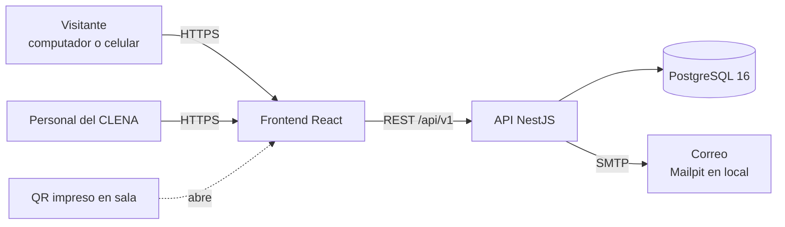
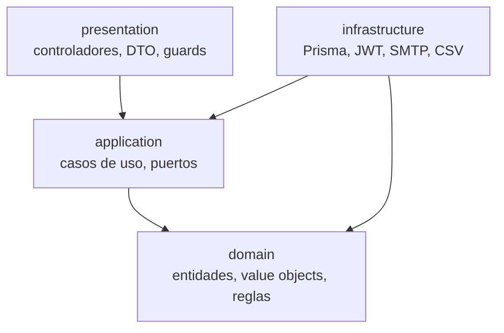

# Arquitectura

> Responsable: Rafael Potes · Revisa: Humberto Llinás · Work item: CLENA-29 (T-08)

## 1. Contexto

El sistema permite que los visitantes de la Biblioteca del CLENA busquen material, vean su ubicación física y su disponibilidad, y completen un tutorial guiado en su primera búsqueda. El personal mantiene el catálogo y registra préstamos y devoluciones.



## 2. Stack

| Componente | Tecnología | Motivo |
|---|---|---|
| Backend | NestJS + TypeScript | Exigido por el enunciado; inyección de dependencias que facilita Clean Architecture |
| ORM | Prisma | Tipado fuerte y migraciones versionadas (ADR-01) |
| Base de datos | PostgreSQL 16 + `pg_trgm` + `unaccent` | Exigido (≥ 15); búsqueda tolerante sin servicios extra (ADR-02) |
| Frontend | React + TypeScript + Vite + Mantine | Exigido React + TS; Mantine ofrece componentes accesibles (ADR-04) |
| Contenedores | Docker + docker-compose | Exigido; mismo entorno para todos |
| CI | GitHub Actions | Exigido |
| Despliegue | Render o Railway | Capa gratuita con PostgreSQL administrado (ADR-05) |

## 3. Módulos

Cada módulo es un contexto del negocio con sus propias capas.

| Módulo | Responsabilidad | Historias |
|---|---|---|
| `iam` | Usuarios, roles, autenticación JWT, consentimiento, eliminación de cuenta | HU-09, HU-16, HU-17, HU-18 |
| `catalog` | Obras, autores, temas, ejemplares, ubicaciones, importación CSV | HU-10, HU-11, HU-12, HU-19 |
| `search` | Búsqueda tolerante, filtros, detalle público, disponibilidad | HU-01, HU-02, HU-03, HU-06, HU-07, HU-08, HU-13 |
| `loans` | Préstamos, devoluciones, reservas, alertas | HU-14, HU-20, HU-21 |
| Frontend transversal | Accesibilidad, QR, tutorial | HU-04, HU-05, HU-15 |
| `shared` | Configuración, errores, logs, Prisma, salud, correo | Transversal |

## 4. Capas y regla de dependencia



Las dependencias apuntan siempre hacia el dominio.

- **domain**: TypeScript puro. Entidades (`Work`, `Copy`, `Loan`…), value objects (`Isbn`, `ShelfLocation`, `Email`), reglas y errores de dominio. Prohibido importar `@nestjs/*`, `@prisma/*` o librerías externas. Una regla de ESLint lo verifica en CI.
- **application**: casos de uso (`SearchWorks`, `RegisterLoan`, `ImportCatalog`…) y **puertos**: interfaces que el caso de uso necesita (`WorkRepository`, `Mailer`, `Clock`, `PasswordHasher`). No conoce HTTP ni Prisma.
- **infrastructure**: adaptadores que implementan los puertos (`PrismaWorkRepository`, `SmtpMailer`, `JwtTokenService`). Los modelos de Prisma se mapean a entidades y no salen de esta capa.
- **presentation**: controladores REST, DTO con `class-validator`, guards y decoradores de Swagger. Solo llaman casos de uso.

Los puertos se registran en el módulo de NestJS con tokens:

```ts
// catalog.module.ts
providers: [
  RegisterWork,
  { provide: WORK_REPOSITORY, useClass: PrismaWorkRepository },
]
```

### Estructura de carpetas

```text
backend/src/
  modules/
    catalog/
      domain/          work.entity.ts, copy.entity.ts, shelf-location.vo.ts
      application/     register-work.use-case.ts, ports/work.repository.ts
      infrastructure/  prisma-work.repository.ts, csv/
      presentation/    works.controller.ts, dto/
      catalog.module.ts
    iam/ search/ loans/
  shared/              config/, errors/, logging/, prisma/, health/, mail/
frontend/src/
  app/ (rutas y layouts)  features/ (search, catalog, loans, auth)  shared/ (api, theme, ui)
```

## 5. Flujo de una petición

Ejemplo: el personal registra un préstamo.

1. `POST /api/v1/loans` llega a `LoansController`. `JwtAuthGuard` valida el access token y `RolesGuard` exige STAFF o ADMIN.
2. `ValidationPipe` valida el DTO (`copyId`, `readerId`).
3. El controlador llama `RegisterLoan.execute()`.
4. El caso de uso carga el ejemplar y el lector por sus puertos. La entidad `Copy` aplica la regla «solo se presta si está Disponible» y `Loan` calcula la fecha de devolución con el `Clock` inyectado.
5. El repositorio guarda préstamo y estado del ejemplar en una transacción. Un índice único parcial (un préstamo activo por ejemplar) evita dos préstamos simultáneos.
6. Un error de dominio (`CopyNotAvailableError`) se traduce en el filtro global a `409` con el formato uniforme.

## 6. API

- Prefijo `/api/v1`. Documentación Swagger en `/docs` (el enunciado la pide ahí). Salud en `/api/v1/health` (incluye chequeo de base de datos), con alias `/health` sin prefijo que pide la Entrega 1. El healthcheck de Docker usa `/api/v1/health`.
- Formato de error único:

```json
{ "statusCode": 409, "error": "Conflict", "message": "El ejemplar ya está prestado", "path": "/api/v1/loans", "timestamp": "2026-11-12T15:04:05.000Z" }
```

- Paginación: `?page=1&pageSize=10`; respuesta `{ data, meta: { page, pageSize, total } }`.

## 7. Seguridad

| Tema | Decisión |
|---|---|
| Autenticación | Access token JWT de 15 min en memoria del frontend; refresh token de 7 días en cookie `httpOnly`, `Secure`, `SameSite=Strict` (ADR-03) |
| Rotación | Cada refresh emite uno nuevo y revoca el anterior. Reutilizar uno revocado invalida la familia completa |
| Roles | `ADMIN` (todo, usuarios, importación, analítica), `STAFF` (catálogo, préstamos, ayuda), `READER` (su cuenta y préstamos) |
| Contraseñas | argon2 (o bcrypt de costo 12) |
| Abuso | Límite de intentos en login y en solicitudes de ayuda (`@nestjs/throttler`) |
| Cabeceras | Helmet; CORS solo para el dominio del frontend |
| Datos personales | Ley 1581 de 2012: aviso, consentimiento registrado con versión, datos mínimos, exportar y eliminar cuenta. Las búsquedas se registran sin datos personales |
| Secretos | Solo en variables de entorno; `.env` fuera del repositorio |

## 8. Búsqueda

1. Normaliza el texto: minúsculas, sin tildes (`unaccent`), espacios simples.
2. Combina coincidencia parcial (`ILIKE`) y similitud de trigramas (`similarity`, operador `%`) sobre título, autores y temas.
3. Ordena por puntuación: coincidencia exacta > parcial > similar.
4. Índices GIN `gin_trgm_ops` sobre columnas normalizadas generadas.

Meta: < 1 s con 5 000 obras.

## 9. Despliegue y entornos

| Entorno | Cómo | Base de datos | Correo |
|---|---|---|---|
| Local | `docker compose up` | Contenedor PostgreSQL 16 | Mailpit (`:8025`) |
| CI | GitHub Actions | Servicio PostgreSQL 16 | Simulado |
| Producción | Render o Railway, despliegue al fusionar en `main` | PostgreSQL administrado | SMTP de la plataforma o simulado |

Las migraciones se aplican con `prisma migrate deploy` al desplegar. Nunca `db push` fuera de local.

## 10. Decisiones (ADR)

### ADR-01 · Prisma como ORM
- **Contexto:** se necesitan migraciones versionadas y tipado.
- **Decisión:** Prisma.
- **Alternativas:** TypeORM (decoradores en entidades, peor para mantener el dominio limpio), Knex (más código manual).
- **Consecuencias:** las búsquedas con trigramas requieren SQL crudo, encapsulado en el adaptador.

### ADR-02 · Búsqueda con `pg_trgm` + `unaccent`
- **Contexto:** se necesita tolerar errores y tildes.
- **Decisión:** extensiones nativas de PostgreSQL.
- **Alternativas:** Elasticsearch o Meilisearch (otro servicio que operar y desplegar).
- **Consecuencias:** suficiente para miles de obras; sin sinónimos ni búsqueda semántica.

### ADR-03 · JWT access + refresh con rotación
- **Contexto:** el enunciado exige access y refresh token.
- **Decisión:** access corto en memoria y refresh en cookie `httpOnly` con rotación y detección de reutilización.
- **Alternativas:** sesiones en servidor (no cumple el enunciado); refresh en `localStorage` (vulnerable a XSS).
- **Consecuencias:** hace falta una tabla de refresh tokens y la lógica de familias.

### ADR-04 · Mantine para la interfaz
- **Contexto:** usuarios mayores; accesibilidad y tamaños configurables.
- **Decisión:** Mantine con tema propio y modo de lectura fácil.
- **Alternativas:** MUI (más pesado), Tailwind (los componentes accesibles se construyen a mano).
- **Consecuencias:** se sigue el sistema de diseño de Mantine.

### ADR-05 · Despliegue en Render o Railway
- **Contexto:** se necesita una URL pública sin costo.
- **Decisión:** plataforma PaaS con PostgreSQL administrado y despliegue desde GitHub.
- **Alternativas:** VPS propio (más operación). Vercel es viable solo para el frontend React/Vite, pero no para la API NestJS (servidor de larga duración y conexiones a PostgreSQL); se mantiene Render o Railway para todo para tener una sola URL y un solo despliegue.
- **Consecuencias:** en la capa gratuita el servicio puede «dormir»; se avisa antes de cada review.

### ADR-06 · Préstamos registrados por el personal
- **Contexto:** el CLENA presta en mostrador.
- **Decisión:** solo STAFF registra préstamos. La cuenta de lector es opcional y sirve para consultar y recibir avisos.
- **Consecuencias:** menos datos personales; el lector sin cuenta se registra con datos mínimos y consentimiento.
