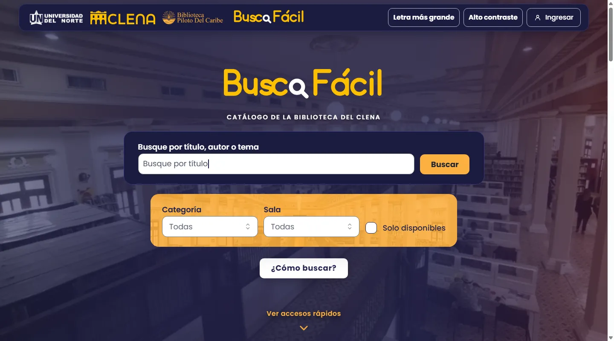
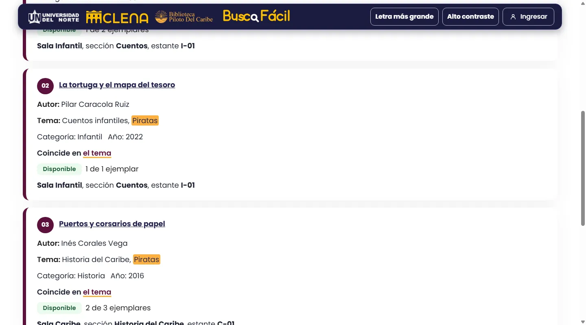
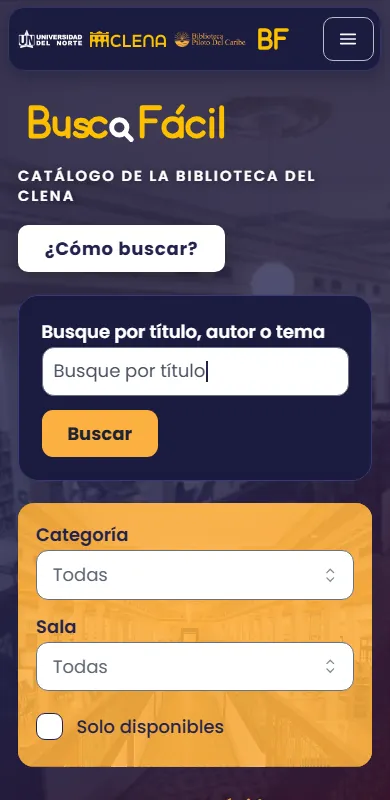
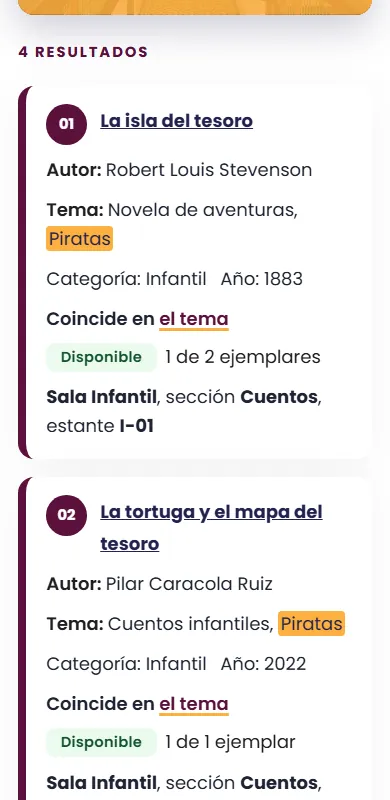

# Guía visual de Busca Fácil

**Tarea:** T-41 · Issue #107 · Plane `CLENA-63`  
**Versión:** 2.0 · 26 de noviembre de 2026 (estilo final aprobado el 20 de noviembre)

Referencia de lo que la interfaz usa de verdad: tema (`frontend/src/shared/theme/theme.ts`), estilos de marca (`frontend/src/app/*.css`, `frontend/src/index.css`), logo (`frontend/src/shared/ui/marca.tsx`) y recursos de `frontend/public/`. El producto se llama **Busca Fácil** («Consulta Fácil» fue el nombre anterior). El estilo parte de la paleta pública del CLENA y de la Biblioteca Piloto del Caribe.

## 1. Paleta y contraste

Los contrastes se calcularon con la fórmula de luminancia relativa de WCAG 2.x. Criterio AA: 4,5:1 en texto normal; 3:1 en texto grande (24 px, o 18,7 px en negrita) y en controles.

### 1.1. Colores de marca

| Color | Hex | Uso | Contraste |
|---|---|---|---|
| Azul marino (`marca`, tono 8, color principal) | `#23234E` | Pie, títulos y enlaces, texto sobre ámbar, foco | Sobre blanco 14,77; blanco encima 14,77 |
| Marino de cabecera | `#1B1B3F` | Cabecera opaca (sin vidrio ni desenfoque) | Blanco encima 16,47; ámbar encima 8,96; amarillo CLENA encima 9,87 |
| Marino, hover (tono 7) | `#2E3470` | Hover de elementos marino | Blanco encima 11,40 |
| Granate (`granate`, tono 8) | `#5B113C` | Acento, números de resultado, rótulos, insignia semántica, hover del botón | Sobre blanco 13,21; blanco encima 13,21 |
| Ámbar (`ambar`) | `#FCB040` | Botón principal, filete de color, resaltado de términos | Texto marino encima 8,03; **sobre blanco solo 1,84: nunca como texto** |
| Amarillo CLENA | `#FCBF01` | Texto del logo y del logo del CLENA en la cabecera | Sobre `#23234E` 8,86; sobre `#1B1B3F` 9,87 |
| Fondo de página | `#F6F7FB` | Fondo; las tarjetas blancas se despegan sin bordes duros | Texto del cuerpo encima 14,44 |

El tema tiene seis tuplas de 10 tonos de Mantine (`marca`, `granate`, `ambar`, `disponible`, `aviso`, `error`); el ámbar usa el mismo `#FCB040` en los tonos 5 a 8 y el granate en el 9 (hover).

### 1.2. Texto y estados

| Color | Hex | Uso | Contraste |
|---|---|---|---|
| Texto | `#1F2433` | Cuerpo (también `black` del tema) | Sobre blanco 15,46 |
| Texto atenuado | `#4A5163` | Ayudas y descripciones (sustituye el gris de Mantine, 3,3:1) | Sobre blanco 7,93; sobre fondo 7,41 |
| Marcador de campo | `#5F6676` | Placeholder | Sobre blanco 5,76 |
| Borde de campo | `#6B7280` | Contorno de campos de formulario | Sobre blanco 4,83 (mínimo 3:1 para controles) |
| Disponible | `#1B5E20` sobre `#E3F4E5` | Insignia «Disponible» (siempre con texto) | 6,87 |
| Aviso | `#6B3F00` sobre `#FFF3D6` | «No disponible» y avisos | 8,15 |
| Error | `#A31621` sobre `#FDE8EA`; `#8E101A` sobre blanco | Alertas y mensajes de campo | 6,65; 9,38 |

Resuelto desde la versión 1: el verde de estado ya no está «por definir» (es `#1B5E20`, tono 8 de `disponible`).

Regla: el relleno ámbar o amarillo lleva siempre texto oscuro (marino o `#1F2433`: 8,03 y 8,41); con texto blanco no pasa.

## 2. Tipografía

- **Poppins**, servida desde el propio sitio con `@fontsource/poppins` (pesos 400, 500, 600 y 700, subconjunto latino con tildes y ñ). No se usa Google Fonts ni CDN. Mientras carga, un respaldo métrico («Poppins Respaldo», Arial escalada) evita que el texto salte; después, la sans-serif del sistema.
- **Tamaño base de 18 px** (`font-size: 112.5 %` en `:root`: respeta el tamaño que la persona configure en su navegador). Todo está en rem y escala con esa base. «Letra más grande» sube la escala a 135 % (21,6 px) y se guarda en el dispositivo.
- Escala (en rem sobre 18 px): h1 2 rem (36 px), h2 1,5 rem (27 px), h3 1,25 rem (22,5 px), h4 1,125 rem; títulos de peso 600; texto `md` de 1 rem. Interlineado de 1,5 a 1,6.
- Controles de al menos 2,75 rem (unos 50 px); radios de 0,5 a 1,5 rem (por defecto 0,75 rem); tarjetas de 16 px de radio.
- Los textos largos se parten (`overflow-wrap: anywhere`): nada se corta a 360 px.

## 3. Logo propio y logos institucionales

### 3.1. Logo de Busca Fácil

Es propio, dibujado en SVG para este proyecto (no pertenece a otra institución). Se eligió el **concepto C, esquema de color 2**; ambos son constantes únicas en `frontend/src/shared/ui/logo-concepto.ts` (`CONCEPTO_LOGO = 'c'`, `ESQUEMA_LOGO = 2`).

- **Concepto C:** logotipo horizontal «Busca Fácil» con una lupa en lugar de la «a» de «Busca». Se dibuja con trazos redondeados y se pinta con variables CSS (`logo.css`). Los otros conceptos probados (A lupa con la B, B libro con lupa, BF antiguo) quedan en `frontend/public/logos-alt/` como alternativas.
- **Esquema 2:** texto amarillo CLENA `#FCBF01` y lupa blanca sobre el marino de la cabecera (texto 8,86 a 9,87:1; lupa 14,77 a 16,47:1). En fondos claros se usa la variante oscura: texto marino `#23234E` y lupa `#B8741A`.
- **«BF» compacto:** la B y la F del logotipo, juntas y con los mismos trazos. Se usa en pantallas angostas (cabecera de menos de 24 rem, móviles de 320 a 360 px) y cuando la cabecera se compacta. Es también el **favicon** y los iconos de la aplicación: amarillo sobre azul marino (`favicon.svg`, `favicon-32.png`, `apple-touch-icon.png`, `icon-192.png`, `icon-512.png`; se regeneran con `node scripts/aplicar-logo.mjs c`).
- En alto contraste el logo pasa a blanco y amarillo `#FFFF00` sobre negro (21:1 y 19,6:1).
- Accesibilidad: en la cabecera el enlace del logo se anuncia como «Busca Fácil, Biblioteca del CLENA: ir al inicio»; el dibujo es decorativo (`aria-hidden`).

### 3.2. Logos institucionales

La cabecera muestra, en una sola fila y a la misma altura, los logos de la **Universidad del Norte**, del **CLENA** y de la **Biblioteca Piloto del Caribe**, y el de Busca Fácil (que lleva al inicio). Los tres primeros enlazan a su sitio oficial en una pestaña nueva. El pie lleva el logo del CLENA en blanco y los créditos en texto.

Son marcas de sus instituciones, usadas solo con fines académicos por decisión del equipo (20 de noviembre de 2026). La autorización escrita del CLENA y de la Universidad del Norte sigue pendiente; si la niegan, se retiran con `git rm` sin cambiar código (el logo que falta desaparece sin dejar imagen rota). El detalle de archivos, origen y retiro está en [`recursos-de-terceros.md`](recursos-de-terceros.md). La versión blanca del logo de Uninorte es una aproximación hasta contar con el SVG oficial de la versión invertida. No se imita ningún logo institucional: el de Busca Fácil es propio.

## 4. Componentes

### 4.1. Cabecera

Una píldora flotante opaca `#1B1B3F` en una sola fila: los cuatro logos a la izquierda y, a la derecha, «Letra más grande», «Alto contraste» e «Ingresar» (botones con contorno blanco; el hover pasa a ámbar). La cabecera se compacta por niveles según el ancho; en celular los logos se reducen (con el «BF» compacto) y las acciones pasan a un único botón «Menú». La ruta activa lleva `aria-current="page"`. Está pegada arriba (sticky) y el foco y las anclas no quedan ocultos tras ella (`scroll-padding-top`, WCAG 2.4.11). Todos los destinos miden al menos 44 px de alto.

### 4.2. Pie

Fondo azul marino `#23234E` con filete ámbar de 4 px arriba. Lleva la marca, los créditos en texto («Corporación Luis Eduardo Nieto Arteta (CLENA)» y «Proyecto académico · Universidad del Norte»), el enlace al aviso de privacidad y la línea de año y «Prototipo académico». Queda pegado al fondo en páginas cortas.

### 4.3. Portada, tarjetas y cuadros de marca

- **Portada:** foto de la biblioteca bajo un filtro azul marino y granate, con el logo como título y debajo la barra de búsqueda (marino) y los filtros (caja ámbar con filete). Sin efecto de vidrio; con `prefers-reduced-transparency` el fondo es sólido.
- **Tarjetas:** fondo blanco, radio de 16 px, sin borde duro y con sombra difusa (`0 8px 50px` al 5 %); en hover o foco interior la sombra se tiñe de azul marino. Las tarjetas de resultado llevan un filete granate a la izquierda y un número en círculo granate (ámbar con texto marino al pasar el cursor).
- **Cuadros de marca** (accesos rápidos, gestión, ingreso): azul marino y granate, con hover ámbar. Filete ámbar de 4 px en los filtros y en los rótulos de sección (granate, mayúsculas).

### 4.4. Resaltado de coincidencias e insignia semántica

| Elemento | Estilo | Contraste |
|---|---|---|
| Término buscado (`mark.marca-termino`) | Fondo ámbar `#FCB040`, texto marino | 8,03 |
| Frase exacta (`mark.marca-frase`) | Fondo granate `#5B113C`, texto blanco | 13,21 |
| «Coincide en el tema» (`.coincidencia`) | El campo en granate, negrita, subrayado ámbar de 3 px | Texto granate sobre blanco 13,21 |
| Insignia «Coincide por significado» (`.insignia-significado`) | Píldora granate con texto blanco de 13 px, peso 700; aparece según el campo `matchSource` | 13,21 |

El subrayado ámbar es solo un ornamento (1,84:1 sobre blanco): el significado lo da el texto «Coincide en …». El resaltado nunca es el único canal: la frase aparece en el texto del resultado.

### 4.5. Botones, campos y foco

- **Botón principal:** relleno ámbar `#FCB040`, texto marino en negrita (8,03:1), radio de 10 px y alto mínimo de 2,75 rem. Hover: fondo blanco con texto granate (13,21:1) en la navegación; el botón de guardar lleva además una sombra ámbar.
- **Campos:** etiqueta visible siempre (peso 600), contorno de 3:1 o más (`#6B7280`), mensaje de error junto al campo (`#8E101A`, 9,38:1). Marcador `#5F6676`.
- **Insignias de estado:** «Disponible» (verde `#1B5E20` sobre `#E3F4E5`) y «No disponible» (aviso `#6B3F00` sobre `#FFF3D6`); siempre con texto. Alertas con filete grueso de 8 px a la izquierda.
- **Foco visible:** contorno de **3 px** del color principal (marino `#23234E`, 14,77:1 sobre blanco y 13,80:1 sobre el fondo de página) con 2 px de separación, en todo control (`:focus-visible`); amarillo `#FFFF00` en alto contraste. Todo se puede usar con teclado y hay un enlace «Saltar al contenido» visible al recibir el foco.

## 5. Alto contraste

El botón «Alto contraste» de la cabecera (`aria-pressed`, se guarda en el dispositivo) pasa toda la interfaz a negro y blanco con amarillo de énfasis, con relaciones de 7:1 o más (AAA):

| Elemento | Colores | Contraste |
|---|---|---|
| Texto | Blanco `#FFFFFF` sobre negro | 21,00 |
| Énfasis, bordes y foco | Amarillo `#FFFF00` sobre negro | 19,56 |
| Enlaces | Celeste `#7FD0FF` sobre negro | 12,37 |
| Término resaltado | Texto negro sobre amarillo | 19,56 |
| Frase exacta | Texto negro sobre blanco, subrayado | 21,00 |
| Insignia semántica | Texto amarillo, borde amarillo de 2 px, fondo negro | 19,56 |

Tarjetas, campos y alertas llevan borde amarillo de 2 px; la cabecera y el pie pasan a negro con texto blanco; las fotos y los efectos decorativos se apagan. El foco es amarillo de 3 px.

## 6. Movimiento reducido y transparencia

- El movimiento es ligero y solo usa `transform` y `opacity`: un brillo diagonal único sobre los elementos de marca, elementos que se deslizan al cargar, revelado al desplazarse y el efecto de escritura del buscador. La intro cinemática (1,9 s, con «Saltar») está apagada por defecto y solo se activa con `VITE_INTRO_CINEMATICA=true`.
- Con `prefers-reduced-motion: reduce` se anulan todas las animaciones y transiciones (también las de Mantine, por `respectReducedMotion`); las transiciones de hover y foco quedan en cambio inmediato.
- Con `prefers-reduced-transparency: reduce` el panel del héroe pasa a color sólido, y con `prefers-reduced-data: reduce` se omiten las fotos de fondo.

## 7. Diseño adaptable (360, 768 y 1280 px)

| Ancho | Comportamiento |
|---|---|
| 360 px (celular) | Una columna, sin desplazamiento horizontal. Cabecera con logos reducidos y «BF» compacto, y un solo botón «Menú». Título del héroe alineado a la izquierda; búsqueda y filtros apilados. Pantallas bajas (800 px de alto o menos) ocultan el subtítulo para que «Ver accesos rápidos» quede a la vista. |
| 768 px (tableta) | Desde 48 em (768 px) el contenido del héroe se centra; los filtros pasan a una fila; los resultados usan todo el ancho. |
| 1280 px (computador) | Cabecera en una fila completa con los cuatro logos y las tres acciones; contenido con ancho máximo de 75 rem; la foto de fondo se aprecia a ambos lados. |

Las capturas son de la versión final con datos ficticios del catálogo de demostración; la foto de fondo es la del recurso de terceros descrito en la sección 3.2.

## 8. Reglas generales

- La disponibilidad nunca se indica solo con color: lleva texto («Disponible», «No disponible» y el motivo).
- Etiqueta visible en cada campo; el error aparece junto al campo.
- Textos en español sencillo; evitar jerga como «signatura» o «call number»: decir «Sala, sección y estante».
- Pestaña del navegador: `favicon.svg` (BF), `manifest.webmanifest` con `theme_color` `#23234E`, `lang="es"`, descripción y metadatos Open Graph sin URL absolutas. El título sigue el patrón «Página · Busca Fácil».
- Sin datos reales del catálogo del CLENA ni datos personales en el repositorio ni en las capturas.
- Quien agregue pantallas debe reutilizar estos tokens (colores del tema, no hex sueltos nuevos), el foco de 3 px, el resaltado `marca-termino`/`marca-frase` y la insignia `insignia-significado`.
