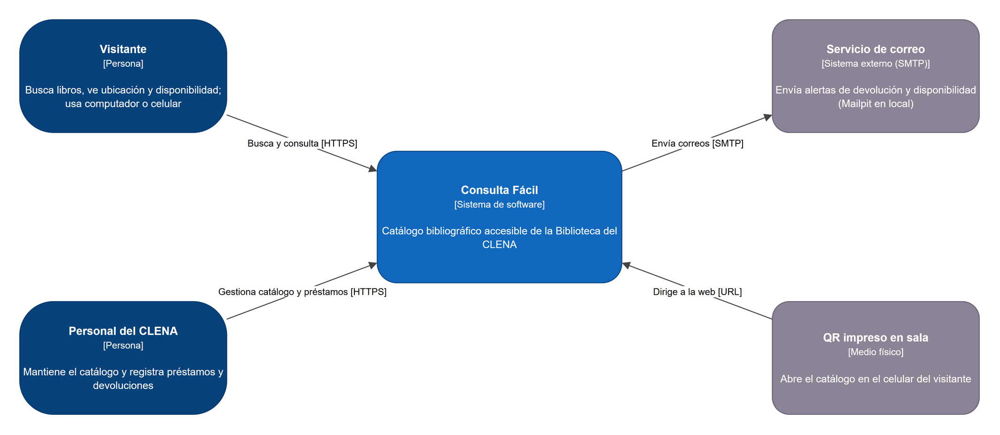

# Inception

## 1. Resumen

Consulta Fácil es el proyecto P2 del curso Desarrollo de Aplicaciones Web Backend (Universidad del Norte): un catálogo bibliográfico web accesible para la Biblioteca del CLENA, en el Complejo de la Aduana de Barranquilla. Reemplaza o complementa el software de consulta actual, que los usuarios describieron como antiguo y poco intuitivo.

El problema, los usuarios y la propuesta de solución provienen del análisis del **Grupo 9** de Introducción a la Ingeniería de Sistemas y Computación (equipo de origen y cliente del proyecto). El equipo de Backend los tradujo en 21 historias de usuario, validadas por el Grupo 9, y las organizó en tres sprints hacia la entrega final del 25 de noviembre de 2026.

Este informe es el acta de la fase de Inception y reúne: las reuniones con el Grupo 9, el problema confirmado, el alcance, el backlog inicial y su validación, los roles, los acuerdos de trabajo, el stack, los riesgos y el calendario. Se complementa con [`backlog.md`](backlog.md) (texto completo de cada historia), [`arquitectura.md`](arquitectura.md), [`evidencias.md`](evidencias.md) y [`daily-scrum.md`](daily-scrum.md).

| Dato | Valor |
|---|---|
| Proyecto | Consulta Fácil, rediseño de la interfaz de consulta bibliotecaria (P2) |
| Repositorio | https://github.com/ByRAPG/clena-catalogo-biblioteca |
| Equipo de origen | Grupo 9: Shadia Castro Romero (contacto principal), Derek Pérez y Emiliano Harvey |
| Repositorio del análisis del G9 | https://github.com/ImDER3K/clena-laboratorio-sistemas-grupo-9 |
| Docente | Daniel Romero (djromero@uninorte.edu.co) |
| Fecha de este informe | 10 de noviembre de 2026 (versión 1.0) |

## 2. Reuniones de Inception

Se hicieron dos reuniones con el Grupo 9 en Microsoft Teams. Cada una tiene su acta en `docs/actas/` y su fila en [`evidencias.md`](evidencias.md).

| Fecha | Reunión | Asistentes de Backend | Asistentes del Grupo 9 | Grabación | Acta |
|---|---|---|---|---|---|
| Martes 3 de noviembre de 2026 | Reunión inicial (unos 33 minutos) | Rafael Potes, Humberto Llinás | Shadia Castro, Derek Pérez, Emiliano Harvey | [Grabación en Teams](evidencias.md), localizada el 11 de noviembre; el acta se redactó el 7 de noviembre a partir de la transcripción automática | [acta](actas/2026-11-03-reunion-inicial-g9.md) |
| Sábado 7 de noviembre de 2026, 6:35 p.m. | Kickoff y validación del backlog (unos 9 minutos) | Rafael Potes, Humberto Llinás | Emiliano Harvey, Shadia Castro | Sí, enlazada en [`evidencias.md`](evidencias.md) | [acta](actas/2026-11-07-kickoff-g9.md) |

Aclaraciones de fechas, para que el informe sea coherente con el historial del repositorio:

- El repositorio se creó el 6 de noviembre de 2026. La reunión inicial del 3 de noviembre es anterior, por lo que su acta se redactó el 7 de noviembre a partir de la transcripción y no tiene commits asociados al 3 de noviembre.
- La reunión inicial sí se grabó; la grabación se localizó el 11 de noviembre y está enlazada en `evidencias.md`. El acta se redactó el 7 de noviembre a partir de la transcripción automática, y esa fecha se declara y no se oculta.
- En el kickoff estuvieron ausentes Derek Pérez (Grupo 9) y Juan Camilo Fernández, Orlando Palma y Daniel Méndez (Backend). Emiliano Harvey se comprometió a avisar a sus compañeros.

### 2.1 Contexto recibido del Grupo 9

El Grupo 9 entregó su análisis en el repositorio indicado en la sección 1: observaciones de la salida de campo, problemas identificados, problema seleccionado y propuesta de solución. En la reunión inicial se discutió además:

- Una ayuda más intuitiva para el usuario, pensando en adultos mayores.
- Un mapa interactivo de la biblioteca propuesto por Derek Pérez, que se tomó como complemento y no como núcleo.
- La prioridad de buscar por lo que la persona recuerda del libro.
- El uso de Figma para el prototipo (el Grupo 9 aún no tenía prototipos).
- El reparto de responsabilidades y la herramienta de gestión (GitHub Projects y Plane).

### 2.2 Evidencias de la visita

La visita al CLENA la hizo el Grupo 9 el **26 de septiembre de 2026, de 9:00 a. m. a 11:00 a. m.**, con Shadia Castro, Derek Pérez y Emiliano Harvey. Recorrieron el Archivo Histórico, el museo (Centro Interactivo de Memoria Urbana), la Biblioteca y la Biblioteca Infantil con un grupo de unas 30 personas, y centraron la observación en la Biblioteca. No hicieron entrevistas formales; se apoyaron en las explicaciones de los guías de cada área.

Las fotografías de la visita (tres imágenes) y las observaciones están en el repositorio del Grupo 9, en `evidencias/fotografias/` y `problema/observaciones.md`. Este informe no las reproduce: son material del Grupo 9 y pueden mostrar a otras personas. Se citan con su enlace y se resumen en las secciones 3 y 4. Ningún dato personal ni imagen del CLENA se copió a este repositorio.

### 2.3 Correo de coordinación

El enunciado exige que las notificaciones al Grupo 9 lleven copia a djromero@uninorte.edu.co. La nueva hora de la review del 10 de noviembre se avisó por correo con copia al docente (consta en el acta de ese día). El correo de convocatoria de la fase de Inception no está archivado en el repositorio: **dato por confirmar** por Rafael Potes antes de la entrega.

## 3. Problema y contexto

Fuente: análisis del Grupo 9 (`problema/problema-seleccionado.md` y `problema/observaciones.md` de su repositorio).

**Enunciado del problema.** En la Biblioteca del CLENA, los usuarios que desean consultar el material tienen dificultades para hacerlo porque el software disponible es antiguo y poco intuitivo. Esto los lleva a perder tiempo, a depender del personal o a abandonar la consulta, lo que limita el aprovechamiento de los recursos de la biblioteca y sobrecarga a sus trabajadores.

### 3.1 Problemas confirmados

| # | Problema | Impacto observado |
|---|---|---|
| 1 | Los usuarios no saben usar el software de consulta; es antiguo y poco intuitivo | Pierden tiempo, desisten y no aprovechan los recursos |
| 2 | Dependencia del personal: cuando el usuario no logra buscar, el personal busca por él | Sobrecarga del personal y esperas |
| 3 | No hay orientación visible para usar el sistema | Los usuarios nuevos se sienten perdidos y es menos probable que regresen |

El Grupo 9 eligió el problema 1 porque es el que observó directamente, afecta a todos los usuarios que consultan el catálogo y origina los otros dos. Otras observaciones relevantes para el diseño:

- Asistieron personas de 15 años en adelante, incluidos adultos mayores; el sistema debe servir a públicos muy distintos.
- Las consultas que se abandonan no quedan registradas, por lo que se pierde información sobre lo que la gente buscaba.
- El personal explica el uso del sistema una y otra vez a cada persona que llega.

### 3.2 Decisiones de alcance

| # | Decisión | Fecha y fuente |
|---|---|---|
| 1 | La prioridad es buscar por lo que la persona recuerda del libro; el mapa de la biblioteca es un complemento, no el núcleo | 3 de noviembre, [acta](actas/2026-11-03-reunion-inicial-g9.md) |
| 2 | Backend tiene su propio repositorio, sin fork del repositorio del Grupo 9 | 3 de noviembre |
| 3 | El **chat de atención queda fuera del alcance**: corresponde al proyecto de la Sala de Internet y se anota como sugerencia futura | 7 de noviembre, [acta](actas/2026-11-07-kickoff-g9.md) |
| 4 | El Grupo 9 valida las 21 historias; Backend las registra como Issues y el Grupo 9 las valida con un comentario en cada una | 7 de noviembre y acuerdo posterior por mensaje |
| 5 | No se suben datos reales del CLENA sin autorización escrita; se usan datos ficticios | 7 de noviembre |
| 6 | El CLENA no entregó información; se mantienen los datos ficticios o de dominio público (Issue #55) | 9 y 10 de noviembre, [acta del Planning](actas/2026-11-09-sprint-planning-1.md) y [acta de la review](actas/2026-11-10-review-avance-g9.md) |
| 7 | El producto no usa inteligencia artificial. El asistente con IA que mencionó el Grupo 9 queda como mejora futura, descartada por costo y complejidad | Propuesta del Grupo 9 y decisión del equipo ([`memoria-critica.md`](memoria-critica.md)) |

## 4. Cliente y usuarios

**Cliente.** El Grupo 9 es el equipo de origen del análisis y valida el backlog. Su Product Owner es Emiliano Harvey; su contacto principal es Shadia Castro Romero. El destinatario final es la Biblioteca del CLENA.

**Actores identificados por el Grupo 9:**

| Actor | Descripción | Rol en el sistema |
|---|---|---|
| Usuario directo | Visitantes, estudiantes e investigadores que buscan material | Usuario público |
| Visitante nuevo | Personas que llegan por primera vez y no conocen el sistema | Usuario público |
| Responsable del proceso | Personal de la biblioteca que atiende y orienta | Personal del CLENA |
| Administrador | Quienes gestionan la biblioteca y el sistema | Administrador |
| Usuario indirecto | Familias, docentes y comunidad que se benefician de una biblioteca más accesible | Sin cuenta |

**Perfiles de trabajo.** Son borradores del equipo de Backend; el Grupo 9 entregará los perfiles oficiales. No son personas reales.

| Perfil | Descripción | Qué necesita lograr |
|---|---|---|
| Doña Carmen, 70 años | Jubilada que lee novelas; poca comodidad con la tecnología | Encontrar un libro que recuerda a medias y saber a qué estante ir |
| Andrés, 20 años | Estudiante universitario | Buscar por tema desde el celular |
| Luisa, 42 años | Investigadora de historia local | Filtrar por tema y disponibilidad |
| Marta, 35 años | Bibliotecaria | Mantener el catálogo y los préstamos al día |

Los tres roles del sistema son **administrador**, **personal del CLENA** y **usuario público** (con o sin cuenta de lector), como exige el enunciado.

## 5. Visión y alcance del MVP

**Visión.** Que cualquier persona, de cualquier edad, pueda consultar el catálogo de la Biblioteca del CLENA por sí sola, desde un computador de la sala o desde su celular, y sepa en qué sala, sección y estante está el libro y si está disponible.

La propuesta del Grupo 9 plantea un buscador simple con resultados claros, ayudas guiadas, códigos QR en la sala y un panel sencillo para que el personal registre y actualice el material. Esa propuesta guía el alcance.

### 5.1 Alcance mínimo comprometido (80 % de la Entrega 1)

El enunciado exige, para el 13 de noviembre, el 80 % del alcance mínimo funcionando de punta a punta, desde la pantalla de React hasta PostgreSQL:

| Funcionalidad obligatoria | Historias |
|---|---|
| Gestión de libros, autores, temas y ejemplares con importación desde CSV | HU-10, HU-11, HU-12, HU-19 |
| Búsqueda por título, autor o tema con filtros y tolerancia a errores de escritura | HU-01, HU-02, HU-08 |
| Resultado con sala, sección, estante y disponibilidad | HU-03, HU-06 |
| Acceso por QR y tutorial guiado de la primera búsqueda | HU-05, HU-15 |
| Requisitos transversales: inicio de sesión con JWT, tres roles, accesibilidad, aviso de privacidad y consentimiento (Ley 1581 de 2012) | HU-09, HU-18, HU-04, HU-16 (y HU-17 en el Sprint 2) |

Lo que el enunciado permite dejar para después (préstamos y alertas de devolución y disponibilidad) se hace en el Sprint 2: HU-20 y HU-21.

### 5.2 Fuera de alcance

| Elemento | Motivo |
|---|---|
| Chat de atención | Corresponde al proyecto de la Sala de Internet (decisión del 7 de noviembre) |
| Asistente con inteligencia artificial | El producto no usa IA; el Grupo 9 lo descartó por costo y complejidad |
| Mapa interactivo de la biblioteca con el estante resaltado | Propuesta del 3 de noviembre; queda como sugerencia, no como historia comprometida |
| Cita bibliográfica, estadísticas de búsquedas sin resultado, botón «Necesito ayuda» | Sugerencias de Backend que el Grupo 9 puede convertir en historias de baja prioridad |
| Datos reales del CLENA | No hay autorización escrita; se usan datos ficticios |
| Aplicación móvil nativa | La solución es web, accesible desde el celular por QR |

## 6. Backlog inicial

El backlog tiene **21 historias** (HU-01 a HU-21) y 19 habilitadores técnicos (T-01 a T-19). Las HU-01 a HU-14 las escribió el Grupo 9; Backend las ajustó al formato Dado/Cuando/Entonces y agregó las HU-15 a HU-21 para cubrir el alcance mínimo y los requisitos transversales. Cada historia tiene de 2 a 4 criterios de aceptación en [`backlog.md`](backlog.md) y en su Issue de GitHub (#28 a #48), con puntos de la serie de Fibonacci y una etiqueta `prioridad:alta`, `prioridad:media` o `prioridad:baja`.

| Historia | Issue | Resumen | Prioridad | Pts | Sprint | Autor G9 |
|---|---|---|---|---|---|---|
| HU-01 | #28 | Buscar por parte del título | alta | 5 | 1 | Shadia |
| HU-02 | #29 | Buscar por autor o tema | alta | 3 | 1 | Shadia |
| HU-03 | #30 | Ver la ubicación del libro | alta | 2 | 1 | Shadia |
| HU-04 | #31 | Interfaz legible para adultos mayores | alta | 3 | 1 | Derek |
| HU-05 | #32 | Abrir el catálogo escaneando un QR | alta | 2 | 1 | Derek |
| HU-06 | #33 | Ver la disponibilidad (física o digital) | alta | 3 | 1 | Derek |
| HU-07 | #34 | Mensaje claro si no hay resultados | media | 2 | 2 | Shadia |
| HU-08 | #35 | Filtrar por categoría o sala | alta | 3 | 1 | Shadia |
| HU-09 | #36 | Iniciar sesión como bibliotecario | alta | 5 | 1 | Emiliano |
| HU-10 | #37 | Registrar un libro nuevo | alta | 5 | 1 | Emiliano |
| HU-11 | #38 | Editar ubicación y estado de un libro | alta | 3 | 1 | Emiliano |
| HU-12 | #39 | Importar el catálogo desde CSV o Excel | alta | 8 | 1 | Emiliano |
| HU-13 | #40 | Búsqueda por voz | baja | 3 | 3 | Shadia |
| HU-14 | #41 | Reservar un libro desde la app | media | 5 | 2 | Derek |
| HU-15 | #42 | Tutorial guiado de la primera búsqueda | alta | 5 | 1 | Shadia |
| HU-16 | #43 | Crear cuenta de lector con aviso de privacidad | alta | 5 | 1 | Derek |
| HU-17 | #44 | Eliminar mi cuenta y mis datos | alta | 3 | 2 | Derek |
| HU-18 | #45 | Gestionar cuentas del personal y roles | alta | 3 | 1 | Emiliano |
| HU-19 | #46 | Registrar los ejemplares de un libro | alta | 3 | 1 | Emiliano |
| HU-20 | #47 | Registrar préstamos y devoluciones | alta | 8 | 2 | Emiliano |
| HU-21 | #48 | Alertas de devolución y disponibilidad | alta | 5 | 2 | Derek |

Resumen: 21 historias, 84 puntos; 18 de prioridad alta, 2 de prioridad media (HU-07 y HU-14) y 1 de prioridad baja (HU-13). Cada integrante del Grupo 9 es autor de siete historias.

### 6.1 Cambios de Backend frente a las historias originales del Grupo 9

| Historia | Cambio | Motivo |
|---|---|---|
| Todas | Criterios reescritos en formato Dado/Cuando/Entonces | Lo exigen los enunciados |
| HU-01 | Se agrega tolerancia a errores de escritura | Alcance mínimo del proyecto |
| HU-06 | Se agrega la disponibilidad digital | El alcance mínimo dice «física o digital» |
| HU-09 | Se agregan cierre y renovación de sesión (refresh token) | Requisito transversal de JWT |
| HU-11 | Ubicación y estado se editan por ejemplar | Un libro puede tener copias en estantes distintos |
| HU-12 | El CSV es obligatorio; Excel se acepta guardado como CSV | El alcance mínimo habla de CSV |
| HU-13 | Pasa a prioridad baja | No es alcance mínimo y depende del navegador |
| HU-14 | Pasa a prioridad media y requiere cuenta de lector | No es alcance mínimo; depende de HU-16 |

### 6.2 Validación del Grupo 9

La validación consta en GitHub, con fechas verificables:

- Las 21 historias (#28 a #48) tienen un comentario de Emiliano Harvey, Product Owner del Grupo 9, del 8 de noviembre de 2026: «Aprobado por el grupo 9».
- Shadia Castro agregó además comentarios de autoría y validación en varias de las historias que le corresponden.
- El 7 de noviembre el Grupo 9 se comprometió a validar el backlog (acuerdo 2 del kickoff) y, el 10 de noviembre, Emiliano Harvey confirmó en la review que el Grupo 9 ya validó las 21 historias ([acta](actas/2026-11-10-review-avance-g9.md)).
- Cuatro Issues de retroalimentación del Grupo 9 (#50 a #53, del 8 de noviembre) señalan el estado de HU-01, HU-04, HU-09 y HU-12. El quinto sigue pendiente del Grupo 9.
- **Firma del acta de Inception por el Grupo 9: pendiente.** Este informe se enviará a Shadia Castro y Emiliano Harvey, con copia al docente. Mientras tanto, la validación se sustenta en los comentarios de los Issues.

## 7. Priorización

Priorizan el Product Owner de Backend (Humberto Llinás) y el Product Owner del Grupo 9 (Emiliano Harvey). El Grupo 9 indicó el 7 de noviembre que, si solo pudieran usarse cinco historias, serían: buscar por título con errores de escritura, ver sala, sección y estante, ver si está disponible, importar el catálogo por CSV y registrar préstamos. La más urgente es la ubicación del libro.

### 7.1 Orden de prioridad del Sprint 1 (acordado el 10 de noviembre)

Rafael Potes leyó el orden en nombre de Humberto Llinás, ausente de la reunión, y Emiliano Harvey lo aceptó. Humberto debe ratificarlo por escrito en el PR del acta. Se mantienen los 58 puntos del Sprint 1:

1. Modelo de datos y semilla: T-06 (#10) y T-17 (#55).
2. Flujo completo: buscar, ver ubicación y disponibilidad (HU-01, 02, 03, 06), iniciar sesión (HU-09), registrar libro y ejemplar (HU-10, 19) e importar el CSV (HU-12).
3. Accesibilidad, filtros, roles, registro de lector, QR y tutorial (HU-04, 08, 11, 18, 16, 05, 15).
4. Lo que no esté completo el jueves 12 de noviembre a las 12:00 m. no se muestra el viernes y pasa al Sprint 2.

Fuente: [`actas/2026-11-10-review-avance-g9.md`](actas/2026-11-10-review-avance-g9.md).

## 8. Roles del equipo

| Persona | GitHub | Rol |
|---|---|---|
| Rafael Potes Molina | `ByRAPG` | Scrum Master, Tech Lead, Release Manager y aprobador principal |
| Humberto Llinás Marimón | `lzayrox` | Product Owner de Backend, revisor de arquitectura y plan, aprobador alterno, infraestructura Docker |
| Juan Camilo Fernández Barrios | `fjuanc` | Development Team |
| Daniel Méndez Aparicio | `danimendeztv-source` | Development Team |
| Orlando Palma | `OrlandoPalmaUN` | Development Team |
| Shadia Castro Romero | `shadiacas-creator` | Grupo 9, contacto principal |
| Derek Pérez | `ImDER3K` | Grupo 9 |
| Emiliano Harvey | `Harvey04-ish` | Grupo 9, Product Owner del Grupo 9 |

Reparto del Sprint 1 (acta del Sprint Planning 1 y [`sprint-planning.md`](sprint-planning.md)):

| Responsable | Historias y tareas |
|---|---|
| Rafael Potes | HU-04, HU-05, HU-15, T-06 (esquema, migración y semilla desde el 10 de noviembre), T-12, T-17 |
| Humberto Llinás | HU-12, T-14 (T-10 y HU-20 después) |
| Juan Camilo Fernández | HU-09, HU-16, HU-18, T-13 (HU-14 y HU-17 en el Sprint 2) |
| Daniel Méndez | HU-06, HU-10, HU-11, HU-19, diagrama entidad-relación de T-06 (HU-21 en el Sprint 2) |
| Orlando Palma | T-03, HU-01, HU-02, HU-03, HU-08 (HU-07 y HU-13 después) |

## 9. Acuerdos de trabajo y Definition of Done

### 9.1 Scrum y GitHub Flow

| Tema | Acuerdo |
|---|---|
| Fuente oficial | GitHub Issues, Milestones y Projects. Plane es planificación interna |
| Tablero | GitHub Projects: Backlog, To Do, In Progress, In Review y Done. A Done solo con el PR fusionado |
| Sprints | Milestones `Sprint 1`, `Sprint 2` y `Sprint 3` |
| Daily Scrum | Mínimo tres por semana, en Teams y grabadas (ver [`daily-scrum.md`](daily-scrum.md)) |
| Ramas | `feat/<issue>-descripcion`, `fix/...` o `docs/...`, siempre desde `main` actualizado |
| Commits | Conventional Commits |
| Pull Requests | Referencian su Issue con `Closes #n` y su `CLENA-n`; describen qué cambia y cómo probarlo |
| Revisión | Un compañero deja una revisión Comment; solo Rafael Potes o, como alterno, Humberto Llinás aprueban y fusionan con squash merge. Rotación: Juan Camilo revisa a Daniel, Daniel a Orlando y Orlando a Juan Camilo |
| `main` | Protegida: sin push directo; PR con aprobación y CI en verde |
| Evidencia | Cada integrante necesita en la entrega al menos un commit, un PR propio y una revisión de un PR ajeno |
| Actas | Con la misma fecha que la grabación, nombrando Issues y PR; las grabaciones no se suben al repositorio, se enlazan |

Detalle en [`flujo-de-trabajo.md`](flujo-de-trabajo.md).

### 9.2 Definition of Done

Una historia o tarea está terminada solo si cumple todo lo siguiente (texto completo en [`definition-of-done.md`](definition-of-done.md)):

| Dimensión | Condiciones |
|---|---|
| Funcional | Cumple los criterios de aceptación de su Issue; se demuestra en vivo (en local mientras no haya despliegue) |
| Código | Rama propia; Clean Architecture (dominio sin `@nestjs` ni `@prisma`; controladores solo llaman casos de uso); sin secretos ni datos reales; sin código comentado ni `console.log` de depuración |
| Pruebas y calidad | Pruebas unitarias de reglas de dominio y casos de uso; prueba e2e si toca un endpoint; lint, pruebas y build en verde en GitHub Actions; cobertura global de al menos 70 % desde el Sprint 2 |
| API e interfaz | Swagger documentado; errores en formato uniforme; pantallas públicas con teclado, texto de al menos 18 px, contraste AA y vista desde 360 px de ancho |
| Revisión y cierre | PR con descripción y cómo probar; revisión del compañero; aprobación y fusión; Issue cerrado y tarjeta en Done; documentación actualizada |

El enunciado añade seis condiciones para que una funcionalidad cuente en el 80 %: caso de uso en la capa de aplicación invocado por un controlador, datos con migración versionada y semilla, endpoint documentado con DTO y paginación, pantalla React con ruta protegida, prueba unitaria en el CI y criterios demostrables en vivo. Una funcionalidad a medias no suma.

## 10. Stack y decisiones técnicas

El stack del enunciado es fijo. El equipo eligió dentro de la libertad que se le deja:

| Componente | Tecnología | Motivo |
|---|---|---|
| Backend | NestJS con TypeScript, Clean Architecture en cuatro capas (`domain`, `application`, `infrastructure`, `presentation`) | Exigido; la inyección de dependencias facilita la arquitectura limpia |
| ORM | Prisma | Tipado fuerte y migraciones versionadas |
| Base de datos | PostgreSQL 16 con `pg_trgm` y `unaccent` | Exigida (versión 15 o superior); búsqueda tolerante a errores sin servicios adicionales |
| Frontend | React con TypeScript, Vite y Mantine | Exigido React; Mantine ofrece componentes accesibles |
| Contenedores | Docker y docker-compose; Mailpit en local para el correo | Exigido; mismo entorno para todos |
| Integración continua | GitHub Actions | Exigido: lint, pruebas y build en cada PR |
| Gestor de paquetes | pnpm | Decisión del equipo (T-15, Issue #24) |
| Despliegue | Render o Railway, en el Sprint 3 (T-07 y T-19) | Capa gratuita con PostgreSQL administrado |

Las decisiones de arquitectura se justifican en [`arquitectura.md`](arquitectura.md). Otras decisiones vigentes: repositorio público con licencia MIT (propuesta del equipo, por confirmar con el CLENA); el uso de IA se permite como asistente en el desarrollo, pero el producto no usa IA; los datos son ficticios o de dominio público hasta contar con autorización escrita del CLENA.

## 11. Riesgos

| Riesgo | Probabilidad | Impacto | Mitigación |
|---|---|---|---|
| El 80 % funcional al 13 de noviembre con un sprint de cinco días | Alta | Alto | Historias en paralelo por módulo; orden de corte acordado el 10 de noviembre; lo que no llegue no se muestra a medias |
| Orlando Palma no confirmó asistencia ni tenía commits el 9 de noviembre; abrió el PR #59 el 10 de noviembre | Media | Alto | Contacto de Rafael; si el 11 no hay avance, se redistribuyen sus tareas y se informa al docente |
| Daniel Méndez no tenía acceso al repositorio el 9 de noviembre | Media | Alto | Aceptó la invitación el 10 de noviembre; se le asignaron #33, #37, #38, #46 y #48 |
| El CLENA no entrega información real | Confirmado | Medio | Semilla y plantilla CSV con datos ficticios (Issue #55); datos reales solo con autorización escrita |
| Informe en formato incorrecto (Markdown o diagramas como código) | Media | Alto | Generador de PDF en `docs/pdf/`; diagramas solo en draw.io como imagen |
| Actas con fechas incoherentes o genéricas | Media | Alto | Acta el mismo día; se nombran Issues y PR; los vacíos se declaran |
| Una persona sin commit, PR propio o revisión | Media | Alto | Reparto y rotación de revisiones; seguimiento en cada Daily |
| Datos reales o secretos en el repositorio | Baja | Alto | Datos ficticios; `.env.example` sin secretos; revisión en cada PR |
| La capa gratuita del despliegue se duerme durante una demo | Media | Medio | Despertar el servicio antes de la review; Docker local como respaldo |

## 12. Calendario

| Etapa | Fechas | Objetivo |
|---|---|---|
| Sprint 0 (Inception) | 6 al 8 de noviembre | Backlog validado, base técnica, borradores de dominio, datos y arquitectura. Reunión inicial (3 de noviembre) y kickoff (7 de noviembre) |
| Sprint 1 | 9 al 13 de noviembre | 80 % del alcance mínimo de punta a punta; 58 puntos; informes en PDF |
| Sprint 2 | 14 al 19 de noviembre | Préstamos, alertas, reserva, eliminar cuenta, mensaje sin resultados; 23 puntos |
| Sprint 3 | 20 al 25 de noviembre | Pulido, cobertura de al menos 70 %, búsqueda por voz si hay capacidad, despliegue, manuales y acta de aceptación; 3 puntos |

Hitos fijos:

| Fecha | Hito | Estado |
|---|---|---|
| 9 de noviembre | Sprint Planning 1 y Daily Scrum 1 | Realizado ([acta](actas/2026-11-09-sprint-planning-1.md)) |
| 10 de noviembre | Review de avance con el Grupo 9 | Realizada ([acta](actas/2026-11-10-review-avance-g9.md)) |
| 11 de noviembre | Daily Scrum 2 (cancelada el 11 nov; seguimiento por escrito); PR del Sprint 1 abiertos con CI en verde (8:00 p.m.); entrega 1 del Grupo 9 | Previsto |
| 12 de noviembre | Congelación (12:00 m.); Daily Scrum 3 (cancelada el 11 nov; seguimiento por escrito) | Previsto |
| 13 de noviembre, 9:00 a. m. | Entrega 1 de Backend (tag `entrega-1`) | Previsto |
| 25 de noviembre | Entrega final, si el docente no la cambia | Por confirmar |

## 13. Pendientes de esta fase

| Pendiente | Responsable |
|---|---|
| Firma o confirmación escrita del Grupo 9 sobre esta acta de Inception | Grupo 9 (Shadia Castro, Emiliano Harvey) |
| Enlace del correo de coordinación con copia al docente | Rafael Potes |
| Ratificación escrita del orden de prioridad del Sprint 1 | Humberto Llinás |
| Quinto Issue `feedback-cliente` | Grupo 9 |
| Perfiles oficiales de usuarios del Grupo 9 (reemplazan los borradores de la sección 4) | Grupo 9 |
| Confirmación de la fecha de la entrega final y de la licencia MIT | Docente y CLENA |
