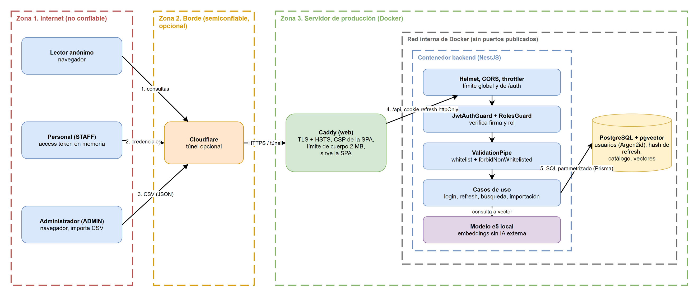

# Informe de seguridad del sistema

Este informe documenta cómo está protegido el Catálogo bibliográfico accesible de la Biblioteca del CLENA, qué se encontró en la auditoría del 20 de noviembre de 2026 y qué queda pendiente. Cada afirmación remite al archivo y la línea donde se puede comprobar, y al PR donde vive el control.

## 1. Alcance y metodología

**Fecha de la auditoría:** 20 de noviembre de 2026.

**Código analizado:** la integración de los 15 PR abiertos del Sprint 2 sobre `main` (carpeta de integración local, en la que se verificó cada referencia `ruta:línea`). Los controles que se corrigieron el mismo día viven en la rama de su PR y se citan con ese PR. Los números de línea corresponden a la integración local; pueden desplazarse unas líneas tras el squash merge.

**Componentes dentro del alcance:** API NestJS (`backend/`), SPA React (`frontend/`), imágenes y composición Docker (`docker-compose*.yml`, `Dockerfile`, `Caddyfile`), automatización de CI (`.github/`).

**Fuera del alcance:** infraestructura del proveedor donde se despliegue, pruebas de penetración contra el despliegue en vivo y el ajuste de los secretos reales de producción (no existen en el repositorio).

**Metodología:**

- Revisión manual del código fuente de autenticación, autorización, validación, cabeceras, configuración y contenedores.
- Referencias: OWASP Top 10 (ediciones 2021 y 2025 coinciden en las categorías usadas aquí; se usa la numeración A01 a A10 de 2021) y OWASP ASVS 4.0 nivel 1.
- Escáneres automáticos: CodeQL (análisis estático, en CI), gitleaks (secretos en el historial), Trivy (dependencias, configuración e imágenes) y `pnpm audit` (dependencias de producción).
- No se ejecutó ninguna prueba contra servicios en vivo. Los datos usados son ficticios.

## 2. Modelo de amenazas

| Actor | Capacidad | Qué busca |
|---|---|---|
| Lector anónimo | Usa la búsqueda y el detalle públicos, sin cuenta | Abusar de la búsqueda (consumo de recursos), leer datos no públicos |
| Personal (STAFF) | Registra y edita obras y salas | Escalar privilegios a administrador |
| Administrador (ADMIN) | Importa el catálogo y gestiona cuentas | Su cuenta es el objetivo de mayor valor |
| Atacante externo | Solo red; sin cuenta | Adivinar contraseñas, tomar una sesión, inyectar código, agotar recursos |

**Activos:** cuentas y credenciales (hash de contraseña, secretos JWT), sesión (access token en memoria y refresh token en cookie), catálogo bibliográfico (integridad y disponibilidad) y el servicio mismo.

La figura muestra los tres límites de confianza (Internet, borde opcional y servidor) y la red interna donde solo está la base de datos. Flujos: 1 consultas del lector; 2 credenciales del personal (el refresh token vuelve en cookie `httpOnly` solo a `/auth` y el access token se guarda en memoria); 3 importación de CSV como JSON, solo `ADMIN`; 4 proxy de Caddy a la API; 5 SQL parametrizado hacia PostgreSQL.

Los datos personales son mínimos: solo correo y rol del personal. El producto no usa IA externa; la búsqueda semántica corre en el propio servidor.

### Resumen STRIDE

| Amenaza | Escenario | Mitigación principal |
|---|---|---|
| Suplantación (S) | Robo o adivinación de credenciales | Argon2id, bloqueo por cuenta, límite por IP, tokens firmados |
| Manipulación (T) | Modificar el catálogo sin permiso | `JwtAuthGuard` y `RolesGuard` en cada ruta de escritura, validación con lista blanca |
| Repudio (R) | Negar una acción de escritura | Registro de la API con nivel configurable; la auditoría detallada queda como mejora |
| Divulgación (I) | Filtrar datos o su existencia | Mensaje único en el login, cabeceras de seguridad, sin `Server` ni `X-Powered-By` |
| Denegación de servicio (D) | Inundar la API o la búsqueda | Límite por IP, tope de cuerpo, tiempo y concurrencia de la búsqueda semántica |
| Elevación (E) | Pasar de lector a administrador | Roles en el token y comprobación en el servidor, importación solo `ADMIN` |

No se incluye diagrama de flujo de datos: la arquitectura ya está en `docs/arquitectura.md` y este informe no añade componentes nuevos.

## 3. Controles implementados

### 3.1 Por categoría OWASP

| Categoría | Control | Evidencia | PR |
|---|---|---|---|
| A01 Control de acceso | `JwtAuthGuard` exige `Authorization: Bearer` y `RolesGuard` aplica el rol; escritura de obras y salas solo `STAFF` y `ADMIN`, importación solo `ADMIN` | `jwt-auth.guard.ts` (`canActivate`); decorador `@Roles` en `catalog-works.controller.ts`, `rooms.controller.ts` e `import-catalog.controller.ts` | Base y #83 |
| A01 Control de acceso | Primer administrador creado por línea de comandos, sin ruta HTTP pública de registro | `backend/src/modules/iam/presentation/create-admin.cli.ts`, `create-initial-admin.use-case.ts` | #120 |
| A02 Fallos criptográficos | Contraseñas con Argon2id; refresh token guardado solo como hash; secretos JWT distintos, de al menos 32 caracteres y sin valores de ejemplo en producción | `argon2-password-hasher.ts` (clase `Argon2PasswordHasher`); `env.validation.ts` (comprobación de longitud en integración; `superRefine` de rechazo de `change-me` e igualdad, rama `wt-seguridad`) | Base y #109 |
| A02 Fallos criptográficos | TLS automático con Caddy y HSTS de un año | `frontend/Caddyfile` (sitio con TLS automático y cabecera `Strict-Transport-Security`) | #118 |
| A03 Inyección | `ValidationPipe` con `whitelist` y `forbidNonWhitelisted`; consultas SQL crudas solo con plantilla etiquetada de Prisma (valores parametrizados); sin `innerHTML` ni `dangerouslySetInnerHTML` en la SPA | `app.setup.ts` (`ValidationPipe`); `prisma-search.repository.ts` (`$queryRaw` con `Prisma.sql`); sin `innerHTML` en el código de producción de `frontend/src` (solo aparece en pruebas) | Base |
| A04 Diseño inseguro | Bloqueo de cuenta tras 5 fallos durante 15 minutos; límite global por IP y límite estricto en rutas de autenticación; tiempo y concurrencia máximos de la búsqueda semántica | `user.entity.ts` (`lockExpiryFrom`, `MAX_FAILED_LOGINS`, `LOCK_DURATION_MINUTES`); `login-user.use-case.ts`; `throttler.config.ts` (límites `default` y `auth`); `env.validation.ts` (`SEMANTIC_TIMEOUT_MS`, `SEMANTIC_MAX_CONCURRENCY`) | Base, #109, #113 |
| A05 Configuración incorrecta | Helmet con CSP de la API en `default-src 'none'`; CSP de la SPA sin `unsafe-inline` en scripts; `Server` y `X-Powered-By` eliminados; CORS con lista de orígenes; `trust proxy` solo si `TRUST_PROXY` lo indica | `security-headers.ts` (`apiHeaders`, `docsHeaders`); `Caddyfile` (bloques `header`, `-Server`, `Content-Security-Policy`); `main.ts` (`trust proxy` y `enableCors`) | #109, #118 |
| A05 Configuración incorrecta | Contenedores de producción sin root, con sistema de archivos de solo lectura, sin capacidades y con límites de memoria; solo `web` publica puertos | `backend/Dockerfile` (`USER node`); `frontend/Dockerfile` (`USER 65532:65532`); `docker-compose.prod.yml` (`read_only`, `cap_drop`, `no-new-privileges`, `mem_limit`) | #114, #118 |
| A05 Configuración incorrecta | Puertos de desarrollo ligados a `127.0.0.1` | `docker-compose.yml` (mapeos `127.0.0.1:` de `ports`, rama `wt-pgvector`) | #108 |
| A06 Componentes vulnerables | Dependabot semanal para npm, GitHub Actions y Docker; `pnpm audit`, Trivy y CodeQL en CI | `.github/dependabot.yml`; `codeql.yml`; `seguridad.yml` (trabajos `gitleaks` y Trivy) | #109, #121 |
| A07 Fallos de autenticación | Mensaje único para correo inexistente, cuenta inactiva y contraseña mala; refresh token en cookie `httpOnly`, `sameSite=strict` y `secure` en producción; rotación con detección de reutilización que cierra la familia | `login-user.use-case.ts` (`execute`); `auth.controller.ts` (opciones de la cookie `httpOnly`, `sameSite`, `secure`); `refresh-session.use-case.ts` (`revokeFamily`) | Base (ADR-03) |
| A08 Integridad de software y datos | Acciones de GitHub fijadas a SHA; binarios de gitleaks y Trivy con versión y SHA-256 verificados; modelo de embeddings con revisión fija | `ci.yml` (`uses:` con SHA, rama `wt-pgvector`); `seguridad.yml` (variables `*_SHA256` y `sha256sum -c`) | #108, #121, #113 |
| A09 Registro y monitoreo | Nivel de registro configurable; filtro global de excepciones que no expone trazas; sonda de salud | `app.setup.ts` (`useGlobalFilters`); `main.ts` (`resolveLogLevels`); `all-exceptions.filter.ts` (`AllExceptionsFilter`) | Base |
| A10 Falsificación de peticiones del servidor (SSRF) | La API no hace peticiones salientes por entrada del usuario; el enlace digital de una obra solo se acepta con `http` o `https` | `frontend/src/shared/texto/url-web.ts` (rama `wt-cabecera`) | #115 |

### 3.2 Lista ASVS nivel 1 (resumen)

| Capítulo ASVS | Estado | Evidencia |
|---|---|---|
| V2 Autenticación | Cumple; H-03 y H-05 corregidos y H-04 corregido en parte (riesgo residual R-08) | Argon2id, bloqueo, mensaje único, hash ficticio, contador atómico |
| V3 Gestión de sesión | Cumple con el riesgo residual R-01 | Cookie `httpOnly`/`strict`, rotación, cierre de familia |
| V4 Control de acceso | Cumple | Guards por rol en cada ruta de escritura |
| V5 Validación | Cumple (H-06 corregido en #142 y #143) | `ValidationPipe`, parámetros SQL, tope JSON de 2 MB |
| V7 Errores y registro | Cumple parcialmente | Filtro de excepciones; sin registro de auditoría de negocio |
| V8 Protección de datos | Cumple | Datos mínimos, sin secretos en el repositorio (gitleaks) |
| V9 Comunicaciones | Cumple en producción | TLS y HSTS en Caddy |
| V12 Archivos | Cumple | Importación CSV solo para `ADMIN`, enviada como JSON limitado |
| V14 Configuración | Cumple | Cabeceras, imágenes mínimas, dependencias vigiladas |

### 3.3 Riesgos del componente de embeddings

| Riesgo | Mitigación |
|---|---|
| Datos importados que alteran el índice | Solo `ADMIN` importa; el texto se valida y se indexa por script, no se ejecuta |
| Consumo de recursos de la búsqueda | `SEMANTIC_TIMEOUT_MS`, `SEMANTIC_MAX_CONCURRENCY` y caché acotada (`env.validation.ts`, variables `SEMANTIC_*`); si falla, cae a la búsqueda léxica |
| Integridad del modelo | Revisión fija del modelo, descarga solo en la construcción y límite de memoria del contenedor (PR #113) |

## 4. Hallazgos de la auditoría del 20 de noviembre

Severidad: **Alta** (explotable con impacto serio sin condiciones especiales), **Media** (explotable con condiciones o impacto limitado), **Baja** (endurecimiento o riesgo teórico).

### 4.1 Arreglados el 20 de noviembre

| Id | Hallazgo | Severidad | Corrección | PR |
|---|---|---|---|---|
| H-01 | Puertos de desarrollo (base, API, Vite, correo) publicados en todas las interfaces; acciones de CI referenciadas por etiqueta móvil | Media | Puertos ligados a `127.0.0.1` (`docker-compose.yml`, `ports`); acciones fijadas a SHA (`ci.yml`) | #108 |
| H-02 | En producción se aceptaban secretos JWT de ejemplo o iguales entre sí; sin Dependabot para Docker | Alta | Rechazo de `change-me` y de igualdad entre secretos (`env.validation.ts`, `superRefine`); ecosistema `docker` en `dependabot.yml` | #109 |
| H-07 | Enlace digital de una obra aceptaba cualquier esquema, incluido `javascript:` | Media | Solo `http:` y `https:` (`url-web.ts`) | #115 |
| H-08 | Caddy no limitaba el cuerpo; solo la API cortaba a 2 MB | Baja | `request_body { max_size 2MB }` para `/api` (`frontend/Caddyfile`, bloque `request_body`, rama `wt-prod`) | #118 |
| H-09 | `ADMIN_PASSWORD` seguía en el entorno del proceso tras crear el administrador | Baja | Se elimina del entorno y se admite `ADMIN_PASSWORD_FILE` (`create-admin.cli.ts`, `delete process.env.ADMIN_PASSWORD`, rama `wt-admin`) | #120 |
| H-03 | El contador de intentos fallidos no era atómico: dos peticiones simultáneas podían contar un solo fallo | Media | Incremento atómico en la base de datos (`failedLogins: { increment: 1 }`) y bloqueo decidido con el valor devuelto (`prisma-user.repository.ts`, `incrementFailedLogins`) | #155 |
| H-04 | La respuesta 429 de «cuenta bloqueada» revelaba que el correo existe | Media | **Corregido en parte.** La cuenta bloqueada responde el mismo 401 genérico que una contraseña incorrecta, sin 429 ni `Retry-After` (`login-user.use-case.ts`). Queda el riesgo residual R-08 | #155 |
| H-05 | Enumeración de correos por tiempo: con correo inexistente no se calculaba ningún hash | Baja | Se verifica un hash ficticio calculado una vez al arrancar (`login-user.use-case.ts`, `dummyHash`) y la contraseña se verifica también con la cuenta bloqueada | #155 |
| H-06 | La importación CSV no tenía tope de filas ni de longitud por campo; solo el límite global de 2 MB | Media | Tope de 1 MB y 5 000 filas por archivo, longitud máxima por campo y máximo de 20 elementos por lista (`csv-limits.ts`, `CSV_IMPORT_LIMITS`; validación en `import-row.ts`) | #142, #143 |

### 4.2 Abiertos y asignados

| Id | Hallazgo | Severidad | Recomendación | Responsable |
|---|---|---|---|---|
| — | Ninguno abierto a la fecha de la entrega (26 nov 2026) | — | — | — |

### 4.3 Riesgos aceptados o residuales

| Id | Riesgo | Severidad | Decisión y recomendación |
|---|---|---|---|
| R-01 | El access token sigue válido hasta 15 minutos tras cerrar sesión o desactivar la cuenta, porque `JwtAuthGuard` solo verifica la firma (`jwt-auth.guard.ts`: `canActivate`) | Baja | Aceptado (ADR-03): vida corta de 15 minutos. Si se exige, comprobar el estado del usuario en cada petición |
| R-02 | Password spraying distribuido: el límite es por IP y el bloqueo por cuenta, de modo que muchas IP con pocas pruebas cada una pasan | Baja | Aceptado: Argon2id encarece cada intento y las contraseñas del personal son pocas. Recomendar contraseñas largas y, a futuro, doble factor para `ADMIN` |
| R-03 | `pnpm audit` del backend: 2 altas transitivas de `prisma > @prisma/config` (`deepmerge-ts` 7.1.5, `effect` 3.21.0, ReDoS) | Baja | **Cerrado el 26 nov** con `overrides` a `deepmerge-ts` 8.0.2 y `effect` 3.22.1 (`backend/pnpm-workspace.yaml`, #152). Prisma 7 se pospone: es una versión mayor y su PR de Dependabot rompía el build |
| R-04 | El tope JSON de 2 MB es global, no por ruta (`app.setup.ts`: `JSON_BODY_LIMIT`) | Baja | Aceptado: Caddy ya corta a 2 MB. Si se amplía, reducir el tope en las rutas que no importan |
| R-05 | La CSP estricta está solo en la SPA; la API usa `default-src 'none'` y `/docs` relaja a `unsafe-inline` para Swagger | Baja | Aceptado: `/docs` no contiene datos. Considerar desactivar `/docs` en producción |
| R-06 | Los secretos viajan en variables de entorno, no en Docker secrets | Baja | Aceptado para una sola máquina. El archivo `.env.prod` no se versiona (`.gitignore`) y se restringe con permisos `600` |
| R-07 | HSTS sin `preload` (`Caddyfile`, cabecera `Strict-Transport-Security`) | Baja | Aceptado: la precarga es difícil de revertir. Revisar cuando el dominio definitivo esté estable |
| R-08 | Un tercero puede bloquear 15 minutos una cuenta ajena con cinco intentos fallidos (parte de H-04) | Baja | Aceptado para la entrega: el límite de 20 peticiones por minuto por IP en `/auth/*` lo mitiga. A futuro, bloquear por pareja correo más IP y avisar al titular por otro canal |

## 5. Resultados de los escáneres

Los escáneres se ejecutaron el 20 de noviembre de 2026 sobre el código de integración, con las mismas versiones que fija `seguridad.yml` (gitleaks 8.30.1 y Trivy 0.76.2), mediante sus imágenes oficiales de Docker.

| Herramienta | Alcance | Resultado |
|---|---|---|
| `pnpm audit --prod` (backend) | Dependencias de producción | 2 vulnerabilidades altas, 0 críticas: `deepmerge-ts` (GHSA-ggr8-5vv4-36mx) y `effect` (GHSA-7589-6fvf-x4pw), ambas por `prisma > @prisma/config` (R-03) |
| `pnpm audit --prod` (frontend) | Dependencias de producción | Sin vulnerabilidades conocidas |
| gitleaks 8.30.1 | Historial completo de git (168 commits), con `--redact` | Sin fugas |
| Trivy 0.76.2, `fs` | Lockfiles de `backend/`, `frontend/` y `docs/pdf/`, severidad HIGH y CRITICAL | Backend: 2 altas (las mismas de R-03, con corrección en `deepmerge-ts` 8.0.0 y `effect` 3.22.1); frontend: 0; `docs/pdf`: 0; críticas: 0 |
| Trivy 0.76.2, `config` | `backend/Dockerfile` y `frontend/Dockerfile`, severidad HIGH y CRITICAL | 0 hallazgos |
| CodeQL | JavaScript y TypeScript | Lo ejecuta GitHub Actions en cada PR y cada lunes (`codeql.yml`); no se corrió de forma local. Consultar la pestaña Seguridad del repositorio |
| Trivy sobre imágenes | Imágenes de producción de backend y frontend | No se ejecutó de forma local; corre en CI (`seguridad.yml`, trabajo `trivy-imagenes`) |
| Cabeceras HTTP | `curl -sI` a `http://localhost:8088/` y a `/api/v1/health` (vista previa local con la misma configuración de Caddy de producción, `frontend/Caddyfile`) | Medidas el 25 de noviembre de 2026; ver la tabla siguiente. No se midieron en una URL pública ni con una herramienta de calificación |

Cabeceras medidas el 25 de noviembre de 2026 con `curl -sI` sobre la vista previa local (Caddy con el `Caddyfile` de producción, `SITE_ADDRESS=:80`, sin TLS). Se midió en local, no en una URL pública.

| Cabecera | Página (`/`) | API (`/api/v1/health`) |
|---|---|---|
| Content-Security-Policy | `default-src 'self'; script-src 'self'; style-src 'self'; style-src-elem 'self' 'unsafe-inline'; img-src 'self' data:; font-src 'self'; connect-src 'self'; object-src 'none'; base-uri 'self'; form-action 'self'; frame-ancestors 'none'` | `default-src 'none'; base-uri 'self'; font-src 'self' https: data:; form-action 'self'; frame-ancestors 'none'; img-src 'self' data:; object-src 'none'; script-src 'self'; script-src-attr 'none'; style-src 'self' https: 'unsafe-inline'; upgrade-insecure-requests` |
| Strict-Transport-Security | `max-age=31536000; includeSubDomains` | igual |
| X-Content-Type-Options | `nosniff` | `nosniff` |
| Referrer-Policy | `strict-origin-when-cross-origin` | igual |
| Permissions-Policy | `accelerometer=(), camera=(), geolocation=(), gyroscope=(), magnetometer=(), microphone=(), payment=(), usb=()` | igual |
| Cross-Origin-Opener-Policy | `same-origin` | `same-origin` |
| Cross-Origin-Resource-Policy | no se envía | `same-origin` |
| X-Frame-Options | no se envía (la protección la da `frame-ancestors 'none'` de la CSP) | `SAMEORIGIN` |
| Server y X-Powered-By | no se envían | no se envían |

## 6. Conclusiones y próximos pasos

**Conclusiones**

- El sistema cubre las categorías OWASP Top 10 relevantes para una aplicación de catálogo sin pagos ni datos personales sensibles. Los controles esenciales (autorización por rol, Argon2id, cookie de sesión endurecida, cabeceras, contenedores sin privilegios, escáneres en CI) están implementados y respaldados por pruebas.
- No hay secretos en el historial ni vulnerabilidades críticas en el código. Las dos altas transitivas de la CLI de Prisma se cerraron con `overrides` (#152). Las alertas de Trivy sobre las imágenes son de paquetes de Debian 12 y de Caddy sin parche publicado: se descartaron el 26 nov como «won't fix» con su justificación y se revisan en el escaneo semanal.
- El endurecimiento del login (H-03, H-04, H-05) quedó corregido en #155; de H-04 se acepta como riesgo residual (R-08) que un tercero bloquee una cuenta ajena. H-06 quedó corregido con los topes de la importación (#142 y #143): no quedan hallazgos abiertos.

**Próximos pasos**

1. Hecho: las correcciones del 20 de noviembre (#108, #109, #115, #118 y #120), T-27 (#155) y T-35/T-36 (#142, #143) están en `main`, con CodeQL, gitleaks y Trivy en verde.
2. Revisar cada semana las alertas descartadas de Trivy por si Debian o Caddy publican el parche (Dependabot vigila las imágenes base).
3. Cuando exista la URL de producción, repetir la medición de cabeceras sobre ella (con una herramienta de calificación) y el análisis de imágenes.
4. Actualizar a Prisma 7 en un PR propio después de la entrega y revisar los PR de Dependabot cada semana.
5. Evaluar, si hay tiempo, comprobar el estado del usuario en cada petición (R-01) y desactivar `/docs` en producción (R-05).
