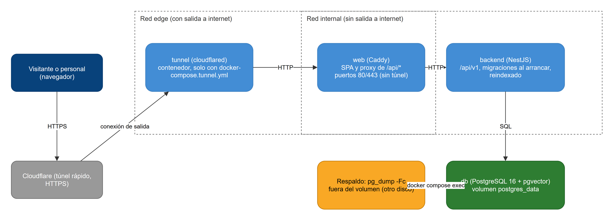

# Manual de operación y respaldo · Consulta Fácil

**Proyecto:** Catálogo bibliográfico accesible para la Biblioteca del CLENA (Universidad del Norte)  
**Tarea:** T-11 · Issue #15 · Plane `CLENA-32`  
**Versión:** 1.0 · 26 de noviembre de 2026  

Este manual es para quien mantiene el sistema encendido: arrancarlo, crear el primer administrador, respaldar y restaurar la base de datos, actualizar la versión y resolver los problemas más frecuentes. Todos los comandos se ejecutan desde la carpeta raíz del repositorio. Los valores entre `<...>` los pone quien opera; nunca se escriben secretos en este manual, en Issues ni en chats.

## 1. Arquitectura de ejecución

La URL de la entrega se publica con Google Cloud Run y Neon (opción B; ver [`despliegue.md`](despliegue.md), T-43). Las secciones de Docker Compose de este manual aplican a la opción A (túnel de respaldo) y a la operación local.

El sistema corre con Docker Compose en una sola máquina. `docker-compose.prod.yml` define tres servicios; `docker-compose.tunnel.yml` agrega un cuarto (`tunnel`) cuando se publica con un túnel rápido de Cloudflare.

| Servicio | Imagen | Función | Memoria máx. |
|---|---|---|---|
| `db` | `pgvector/pgvector:0.8.1-pg16` | PostgreSQL 16 con la extensión `vector`. Datos en el volumen `postgres_data`. | 512 MB |
| `backend` | `./backend` (NestJS) | API en `/api/v1`. Al arrancar aplica las migraciones (`prisma migrate deploy`) y luego inicia la API. No ejecuta la semilla de demostración. | 1 GB |
| `web` | `./frontend` (Caddy) | Sirve la aplicación web, reenvía `/api/*` al backend y, con un dominio propio, obtiene el certificado HTTPS. | 128 MB |
| `tunnel` | `cloudflare/cloudflared` (fijada por digest) | Solo con el override del túnel: publica `web` en una URL `https://<palabras>.trycloudflare.com`. | 128 MB |



Las redes son dos: `internal` (sin salida a internet; une `db`, `backend` y `web`) y `edge` (con salida; une `web` y `tunnel`). Con el túnel no se publican puertos en la máquina; sin túnel, `web` publica el 80 y el 443.

Para operar sin repetir los archivos, en esta guía se usa la variable `DC`. En Linux o Git Bash:

```bash
DC="docker compose --env-file .env.prod -f docker-compose.prod.yml -f docker-compose.tunnel.yml"
```

En PowerShell: `$DC = "docker compose --env-file .env.prod -f docker-compose.prod.yml -f docker-compose.tunnel.yml"` y se usa como `& docker compose ...` (o se escribe el comando completo). Si no se usa el túnel (dominio propio), se quita `-f docker-compose.tunnel.yml`.

## 2. Requisitos

- Docker con Compose v2.24 o superior.
- 2 GB de RAM libres para Docker (4 GB recomendados: al compilar las imágenes y con la búsqueda semántica activa).
- Salida a internet (puerto 7844 hacia Cloudflare para el túnel; pull de imágenes la primera vez).
- Git y OpenSSL (en Windows, Git Bash trae `openssl`).
- Con dominio propio: un registro DNS que apunte a la máquina y los puertos 80 y 443 libres.

## 3. Primer arranque

El procedimiento completo (variables de `.env.prod`, generación de secretos, levantar los servicios y obtener la URL del túnel) está en [`docs/despliegue.md`](despliegue.md); no se repite aquí. En resumen:

1. `cp .env.prod.example .env.prod` y rellenar los valores (el archivo está ignorado por git).
2. `$DC up -d --build` (la primera vez compila las imágenes, unos 2 minutos o más).
3. Esperar a que `$DC ps` muestre `db`, `backend` y `web` en `healthy`.
4. Verificar la salud (sección 11) y crear el primer administrador (sección 4).

## 4. Crear el primer administrador

La semilla de demostración no corre en producción, así que al inicio no existe ninguna cuenta. El comando del CLI crea el primer administrador; los datos van por variables de entorno y la contraseña (mínimo 12 caracteres) nunca se imprime.

En Linux o Git Bash:

```bash
read -rsp 'Contraseña del administrador (mínimo 12 caracteres): ' ADMIN_PASSWORD; echo
$DC exec \
  -e ADMIN_EMAIL=admin@tu-dominio.org -e ADMIN_PASSWORD \
  -e ADMIN_FULL_NAME='Nombre del administrador' \
  backend node dist/modules/iam/presentation/create-admin.cli.js
unset ADMIN_PASSWORD
```

En PowerShell 7: `$env:ADMIN_PASSWORD = Read-Host 'Contraseña' -MaskInput` antes del `exec` y `Remove-Item Env:ADMIN_PASSWORD` al terminar.

| Variable | Obligatoria | Detalle |
|---|---|---|
| `ADMIN_EMAIL` | Sí | Correo con el que inicia sesión. |
| `ADMIN_PASSWORD` o `ADMIN_PASSWORD_FILE` | Sí (una) | Contraseña, o ruta de un archivo que la contenga (por ejemplo un secreto de Docker). El archivo evita dejarla en el entorno. |
| `ADMIN_FULL_NAME` | No | Por defecto `Administrador`. |
| `ADMIN_ALLOW_ADDITIONAL` | No | `true` para crear otro administrador cuando ya hay uno activo. |

Códigos de salida: `0` creado (o la cuenta ya existía; no se cambia nada), `2` dato faltante o inválido, `3` ya hay un administrador activo y no se pasó `ADMIN_ALLOW_ADDITIONAL=true`, `1` error inesperado (revisar la conexión con la base).

## 5. Respaldo y restauración de la base de datos

Todo lo que importa (obras, ejemplares, usuarios, préstamos, embeddings) está en PostgreSQL, dentro del volumen `postgres_data`. **No hay respaldo automático**: sin una copia fuera de la máquina, perder el volumen (por ejemplo con `down -v`) significa perder los datos.

### 5.1. Hacer un respaldo

El respaldo se hace con `pg_dump` en formato personalizado (`-Fc`: comprimido y apto para `pg_restore`), ejecutado dentro del contenedor `db`. El archivo se escribe en la máquina, fuera del volumen.

Linux o Git Bash:

```bash
mkdir -p respaldos
$DC exec -T db sh -c 'pg_dump -Fc -U "$POSTGRES_USER" "$POSTGRES_DB"' > "respaldos/clena-$(date +%Y%m%d-%H%M).dump"
```

PowerShell (la redirección `>` de PowerShell 5.1 corrompe archivos binarios, por eso se usa `cmd /c`; el usuario y la base son los de `.env.prod`, por defecto `clena` y `clena_catalogo`):

```powershell
New-Item -ItemType Directory -Force respaldos | Out-Null
$f = "respaldos\clena-$(Get-Date -Format 'yyyyMMdd-HHmm').dump"
cmd /c "docker compose --env-file .env.prod -f docker-compose.prod.yml -f docker-compose.tunnel.yml exec -T db pg_dump -Fc -U clena clena_catalogo > $f"
```

El respaldo se hace con el sistema en marcha: `pg_dump` toma una copia consistente sin detener la aplicación. La carpeta `respaldos/` contiene datos del sistema: no se sube a git (agregarla a `.git/info/exclude` o guardar fuera del repositorio).

### 5.2. Verificar el respaldo

Un respaldo sin verificar no es un respaldo. Dos comprobaciones:

```bash
ls -l respaldos/                                   # el tamaño no debe ser 0 ni casi 0
$DC exec -T db pg_restore --list < respaldos/<archivo>.dump | head
```

`pg_restore --list` lee el índice del archivo; si está truncado o dañado, falla. Debe mostrar el nombre de la base y las tablas. La prueba definitiva es restaurar en una base de pruebas (sección 5.4).

### 5.3. Restaurar

Restaurar reemplaza los datos actuales por los del respaldo. Se detiene el backend para que nadie escriba durante la restauración y se vuelve a levantar al final:

```bash
$DC stop backend web
$DC exec -T db sh -c 'pg_restore --clean --if-exists --no-owner -U "$POSTGRES_USER" -d "$POSTGRES_DB"' < respaldos/<archivo>.dump
$DC start backend web
```

PowerShell:

```powershell
cmd /c "docker compose --env-file .env.prod -f docker-compose.prod.yml -f docker-compose.tunnel.yml exec -T db pg_restore --clean --if-exists --no-owner -U clena -d clena_catalogo < respaldos\<archivo>.dump"
```

`--clean --if-exists` borra y recrea cada objeto del respaldo. Si la base está vacía (volumen nuevo tras `down -v`), se quitan esas dos opciones o se dejan: funciona igual. Tras restaurar:

1. Esperar a que `backend` y `web` estén `healthy` (`$DC ps`).
2. Comprobar `/api/v1/health` (sección 11).
3. Entrar a la aplicación y abrir una ficha y una búsqueda conocidas; contar filas si hace falta:

```bash
$DC exec -T db sh -c 'psql -U "$POSTGRES_USER" -d "$POSTGRES_DB" -c "SELECT count(*) FROM works;"'
```

(Las tablas principales son `works`, `copies`, `users`, `loans` y `work_embeddings`.) Los embeddings viajan dentro del respaldo; no hace falta reindexar tras restaurar.

### 5.4. Probar la restauración sin tocar producción

Cada trimestre, o antes de una entrega, conviene ensayar en un proyecto Compose aparte con otro nombre (no toca los datos reales):

```bash
DCT="docker compose -p clena-prueba --env-file .env.prod -f docker-compose.prod.yml"
$DCT up -d db                                     # volumen propio: clena-prueba_postgres_data
$DCT exec -T db sh -c 'pg_restore --no-owner -U "$POSTGRES_USER" -d "$POSTGRES_DB"' < respaldos/<archivo>.dump
$DCT exec -T db sh -c 'psql -U "$POSTGRES_USER" -d "$POSTGRES_DB" -c "\dt"'
$DCT down -v                                      # borra solo el proyecto de prueba
```

El `-p clena-prueba` es lo que separa los volúmenes; `down -v` con otro nombre de proyecto nunca borra los datos de producción. Esta misma secuencia (con `pg_dump`, borrado de datos y `pg_restore`, también sobre un volumen nuevo) se ejecutó con éxito al preparar este manual con datos ficticios, incluida la extensión `vector`.

### 5.5. Frecuencia y dónde guardar

| Cuándo | Qué |
|---|---|
| Antes de cada actualización de versión y antes de importar un CSV grande | Respaldo manual |
| Cada día en que se cargaron o prestaron libros (recomendado: diario) | Respaldo |
| Cada semana | Copia del último respaldo fuera de la máquina |

- Guardar en **otro disco o servicio** distinto del que aloja Docker (disco externo, unidad en la nube de la institución). Un respaldo en el mismo disco no protege contra la falla del disco.
- Conservar al menos los últimos 7 diarios y 4 semanales; borrar el resto.
- El respaldo contiene datos de usuarios (correos, hashes de contraseña, préstamos): guardarlo cifrado o con acceso restringido y nunca subirlo a GitHub.

### 5.6. Respaldo y restauración en Neon

En la opción B la base de datos está en Neon, no en el volumen `postgres_data`.

- **Historial:** Neon guarda el historial y permite restaurar una rama a un punto en el tiempo desde su consola (Branches → Restore), dentro de la ventana de retención del plan gratuito.
- **Volcado:** además se puede sacar un volcado con la cadena de conexión directa (no la del pooler): `pg_dump "$DATABASE_URL" -Fc -f respaldo.dump`. Nunca se sube el volcado al repositorio.
- **Restaurar:** `pg_restore --clean --no-owner -d "$DATABASE_URL" respaldo.dump`. Si cambió el catálogo, después se ejecuta `pnpm run search:reindex`.
- **Secretos:** `DATABASE_URL` y los secretos JWT viven en Secret Manager de Google Cloud, nunca en el repositorio.
- **Migraciones:** corren solas al arrancar el contenedor (`prisma migrate deploy`).

## 6. Reindexar embeddings

La búsqueda semántica usa un vector por obra (tabla `work_embeddings`). Si `SEMANTIC_SEARCH=on`, el backend reindexa solo: una pasada al arrancar y otra cada `SEMANTIC_REINDEX_INTERVAL_SECONDS` segundos (300 por defecto; `0` desactiva el intervalo), en lotes de `SEMANTIC_REINDEX_BATCH_SIZE` (16 por defecto, máximo 500). Una obra nueva o importada queda indexada en la siguiente pasada.

Para forzar una pasada completa a mano (por ejemplo tras importar muchos libros o cambiar de modelo):

```bash
$DC exec backend node dist/modules/search/presentation/search-reindex.cli.js
```

Espera a que cargue el modelo, procesa todo lo pendiente e imprime un resumen en JSON. Termina con código `1` si algún elemento falló. Con `SEMANTIC_SEARCH=off` o `EMBEDDING_PROVIDER=fake` los vectores no son útiles para búsqueda real: para el modelo real se usa `SEMANTIC_SEARCH=on` y `EMBEDDING_PROVIDER=local` en `.env.prod`, y `$DC up -d` para aplicar.

## 7. Importar el catálogo desde CSV

Lo hace un administrador desde la aplicación, en `/gestion/importar` (el paso a paso está en el [Manual de usuario](manual-usuario.md)). Lo que debe saber quien opera:

- Formato: CSV UTF-8 separado por comas, con las cabeceras de la plantilla (`GET /api/v1/catalog/imports/template`).
- Límite de tamaño: **1 MB** por archivo (la interfaz lo valida; la API acepta JSON de hasta 2 MB y Caddy corta por encima de eso). Archivos más grandes se parten en varios.
- Límite de filas: **5 000 por archivo**, que incorpora el PR #143 (codificación, separador, alias y límites de importación); mientras ese PR no esté fusionado en la versión desplegada, el único tope es el de tamaño. Más de 5 000 filas se parten en varios archivos.
- Las filas válidas se importan aunque otras tengan errores; cada fila va en su propia transacción. Repetir el mismo archivo no duplica obras (se reutilizan por ISBN y por código de inventario).
- Un fallo de infraestructura a mitad de carga conserva las filas ya confirmadas; no se revierte todo.
- Haga un respaldo antes de una carga grande (sección 5) y, después, una pasada de reindexado si no espera a la automática (sección 6).

## 8. Actualizar la versión

```bash
# 1. Respaldo (sección 5.1)
git pull
$DC up -d --build
$DC ps
```

`up -d --build` recompila las imágenes y recrea solo los servicios que cambiaron. Al arrancar, el backend ejecuta `prisma migrate deploy` (lo hace el entrypoint de la imagen): aplica las migraciones versionadas pendientes y no borra datos. Si una migración falla, el backend no arranca y el motivo queda en `$DC logs backend`. Para volver atrás: `git checkout <versión anterior>`, `up -d --build` y, si la migración ya modificó la base, restaurar el respaldo de antes de actualizar.

Con el túnel, recrear el servicio `tunnel` cambia la URL pública; si solo cambió el backend, la URL se mantiene. Nunca se usa `down -v` para actualizar: borra el volumen de la base.

## 9. Rotar los secretos JWT

Se rotan `JWT_ACCESS_SECRET` y `JWT_REFRESH_SECRET` si se sospecha que se filtraron, o cuando alguien con acceso a `.env.prod` deja el equipo.

```bash
openssl rand -hex 32   # nuevo JWT_ACCESS_SECRET
openssl rand -hex 32   # nuevo JWT_REFRESH_SECRET (distinto)
# editar .env.prod con los dos valores
$DC up -d              # recrea el backend con los nuevos secretos
```

**Efecto: todas las sesiones abiertas dejan de ser válidas** y cada persona tendrá que iniciar sesión de nuevo. Los datos no se alteran. La contraseña de la base (`POSTGRES_PASSWORD`) no se cambia con esta operación: cambiarla exige además `ALTER USER` dentro de la base; solo se hace con un respaldo reciente a mano.

## 10. Revisar logs

```bash
$DC logs --tail 100 backend       # API: arranque, migraciones, errores
$DC logs --tail 100 web           # Caddy
$DC logs tunnel                   # URL del túnel
$DC logs -f backend               # seguir en vivo (Ctrl+C para salir)
```

El nivel de detalle se ajusta con `LOG_LEVEL` en `.env.prod` (`info` por defecto; `debug` para investigar un caso y luego volver a `info`). Los logs no deben contener contraseñas; si ve alguna, rote el secreto afectado.

## 11. Revisar la salud

```bash
$DC ps                                              # estado healthy de db, backend y web
curl -s https://<url-publica>/api/v1/health         # también /health
```

Respuesta esperada: `ok` cuando la base responde; `degraded` si el backend no logra conectar con PostgreSQL (revisar `$DC logs db` y que `db` esté `healthy`). El contenedor `backend` tiene su propio chequeo de salud sobre esa misma ruta. Swagger está en `/docs` del backend.

## 12. Problemas frecuentes

| Síntoma | Causa y solución |
|---|---|
| El sitio no responde justo después de arrancar | El backend aplica migraciones y, con el modelo de embeddings, tarda más en cargar. Esperar a que `backend` pase a `healthy` (`$DC ps`); la primera búsqueda semántica puede tardar un poco más. |
| `backend` se reinicia o el sistema va lento | Poca memoria: Docker necesita 2 GB libres (4 GB recomendados). Cerrar otros programas, subir la memoria asignada a Docker, o dejar `SEMANTIC_SEARCH=off`. |
| La URL del túnel cambió y los QR impresos ya no abren | Es normal: la URL de `trycloudflare.com` cambia cada vez que el túnel se reinicia (reinicio del PC, `down`/`up`, actualización). Obtener la nueva con `$DC logs tunnel` y actualizar `PUBLIC_WEB_URL`; no imprimir QR definitivos con esa URL. Para una dirección fija se necesita un dominio propio. |
| No se puede iniciar sesión (la página carga pero la sesión no se guarda) | La cookie de sesión es `Secure` en producción: exige HTTPS. Entrar por la URL `https://` del túnel o del dominio, no por `http://localhost`. |
| Error al subir: `port is already allocated` (puerto 80 u 443) | Otro programa usa el puerto. Con el túnel no hace falta: el override los libera. Sin túnel, detener el otro programa o cambiar su puerto. |
| `up` falla con `Define POSTGRES_PASSWORD en .env.prod` (u otra variable) | Falta un valor obligatorio en `.env.prod` (contraseña de la base, secretos JWT, `PUBLIC_WEB_URL`). Completarlo. |
| `invalid ... !reset` | Compose anterior a 2.24. Actualizar Docker. |
| El sitio solo está disponible mientras la máquina esté encendida | Limitación del túnel rápido: sin SLA y sin disponibilidad si la máquina o internet caen. |
| Se borró el volumen por error | Restaurar el último respaldo en un volumen nuevo (sección 5.3). |

## 13. Lista de comprobación antes de una demo

- [ ] Respaldo reciente hecho y verificado (sección 5), guardado fuera de la máquina.
- [ ] Máquina enchufada, sin suspensión automática, con internet estable.
- [ ] `$DC ps`: `db`, `backend` y `web` en `healthy` (y `tunnel` en ejecución).
- [ ] URL pública obtenida con `$DC logs tunnel` y abierta desde otro dispositivo (por ejemplo un celular con datos).
- [ ] `/api/v1/health` responde `ok`.
- [ ] Inicio de sesión de administrador probado (si ya no se recuerda la clave, crear otro con `ADMIN_ALLOW_ADDITIONAL=true`).
- [ ] Una búsqueda por título y una semántica devuelven resultados; abrir una ficha con su ubicación y un código QR.
- [ ] Catálogo con datos ficticios o autorizados; sin datos personales reales a la vista.
- [ ] Si se cambió la URL, `PUBLIC_WEB_URL` actualizado y backend recreado.
- [ ] Plan B: capturas o grabación de la aplicación a mano por si falla la red.
