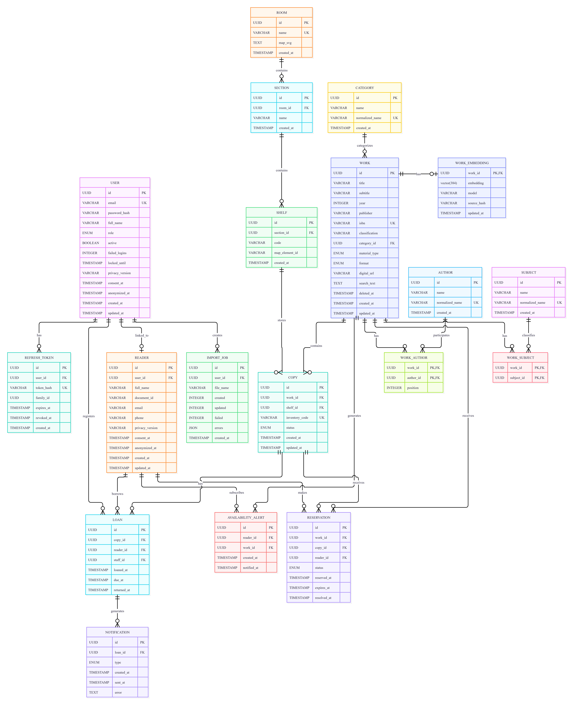

# Modelo de datos

> Responsable: Daniel Méndez · Work item: CLENA-27 (T-06). Este diagrama refleja el esquema de `backend/prisma/schema.prisma` y se actualiza con cada migración. La fuente editable es `docs/diagramas/ModeloER.drawio` (draw.io).

## Resumen de entidades

| Grupo | Tablas | Descripción |
|---|---|---|
| Usuarios y lectores | `users`, `refresh_tokens`, `readers` | Cuentas con rol (`ADMIN`, `STAFF`, `READER`), tokens de refresco con familia de rotación y lectores, que pueden existir sin cuenta |
| Catálogo | `works`, `authors`, `subjects`, `categories`, `work_authors`, `work_subjects`, `copies` | Obras con sus autores, temas y categoría; cada obra tiene uno o más ejemplares físicos |
| Búsqueda semántica | `work_embeddings` | Módulo `search`. Vector de 384 dimensiones por obra, con el modelo que lo generó y el hash del texto fuente (T-24) |
| Ubicación | `rooms`, `sections`, `shelves` | Sala, sección y estante donde se encuentra cada ejemplar |
| Préstamos y reservas | `loans`, `reservations`, `notifications`, `availability_alerts` | Préstamos de ejemplares a lectores, reservas, recordatorios por préstamo y avisos de disponibilidad |
| Importación | `import_jobs` | Registro de cada importación de catálogo: archivo, filas creadas, actualizadas y fallidas |

## Diagrama entidad-relación

## Reglas e índices

| Regla | Cómo se garantiza |
|---|---|
| Un ejemplar solo tiene un préstamo activo | Índice único parcial `loans(copy_id) WHERE returned_at IS NULL` + regla de dominio |
| Un ejemplar solo tiene una reserva activa | Índice único parcial `reservations(copy_id) WHERE status = 'ACTIVA'` |
| Una alerta pendiente por lector y obra | Índice único parcial `availability_alerts(reader_id, work_id) WHERE notified_at IS NULL` |
| No duplicar autores, temas ni categorías | Único en `normalized_name` |
| Código de inventario único | Único en `copies.inventory_code` |
| Recordatorio único por préstamo y tipo | Único `notifications(loan_id, type)` |
| Búsqueda rápida y tolerante | Índice GIN `gin_trgm_ops` sobre `works.search_text`, `authors.normalized_name`, `subjects.normalized_name` |
| Borrado lógico de obras | `works.deleted_at`; la búsqueda pública filtra `deleted_at IS NULL` |
| Eliminación de cuenta (Ley 1581) | Se anonimizan los datos de `users` y `readers` (`anonymized_at`); se conservan los préstamos sin datos personales |
| Un vector por obra, que se borra con ella | `work_embeddings.work_id` es clave primaria y foránea a `works(id)` con `ON DELETE CASCADE` (relación 1 a 0..1) |
| Detectar vectores obsoletos | `work_embeddings.model` (nombre y versión del modelo) y `source_hash` (SHA-256 del texto fuente: título, autores, temas y categoría); se regenera si cambia alguno |
| Búsqueda semántica exacta | Extensión `vector` (pgvector) creada en la migración `20261116000000_work_embeddings`; columna `vector(384)` y distancia coseno `<=>`, sin índice aproximado (HNSW/IVFFlat) por decisión de diseño |

## Tabla `work_embeddings`

| Columna | Tipo | Clave | Descripción |
|---|---|---|---|
| `work_id` | `UUID` | PK, FK | Obra a la que pertenece el vector; borrado en cascada |
| `embedding` | `vector(384)` | | Vector de la obra (no lo lee Prisma: se accede con SQL parametrizado) |
| `model` | `VARCHAR` | | Nombre y versión del modelo que lo generó |
| `source_hash` | `VARCHAR` | | SHA-256 (hex) del texto fuente con el que se generó |
| `updated_at` | `TIMESTAMP` | | Fecha de la última escritura |
