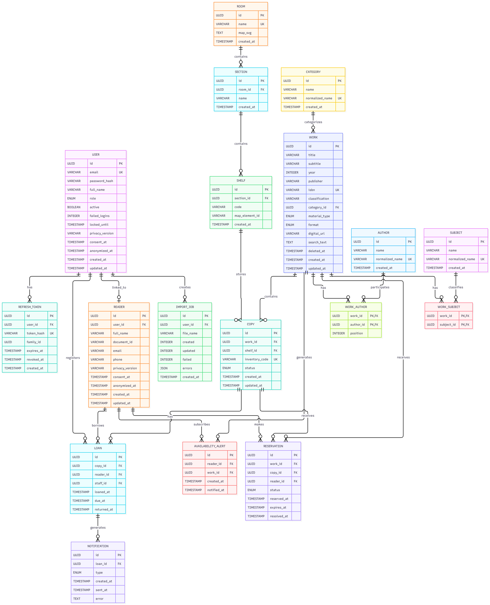

# Modelo de datos

> Responsable: Daniel Méndez · Work item: CLENA-27 (T-06). Este diagrama es el punto de partida; se actualiza con cada migración.

## Reglas e índices

| Regla | Cómo se garantiza |
|---|---|
| Un ejemplar solo tiene un préstamo activo | Índice único parcial `LOAN(copyId) WHERE returnedAt IS NULL` + regla de dominio |
| No duplicar autores ni temas | Único en `normalizedName` |
| Código de inventario único | Único en `COPY.inventoryCode` |
| Recordatorio único por préstamo y tipo | Único `NOTIFICATION(loanId, type)` |
| Búsqueda rápida y tolerante | Índice GIN `gin_trgm_ops` sobre `WORK.searchText`, `AUTHOR.normalizedName`, `SUBJECT.normalizedName` |
| Borrado lógico de obras | `WORK.deletedAt`; la búsqueda pública filtra `deletedAt IS NULL` |
| Eliminación de cuenta (Ley 1581) | Se borran o anonimizan los datos de `USER` y `READER`; se conservan los préstamos sin datos personales |
| Sin datos personales en analítica | `SEARCH_LOG` no guarda usuario ni IP |
