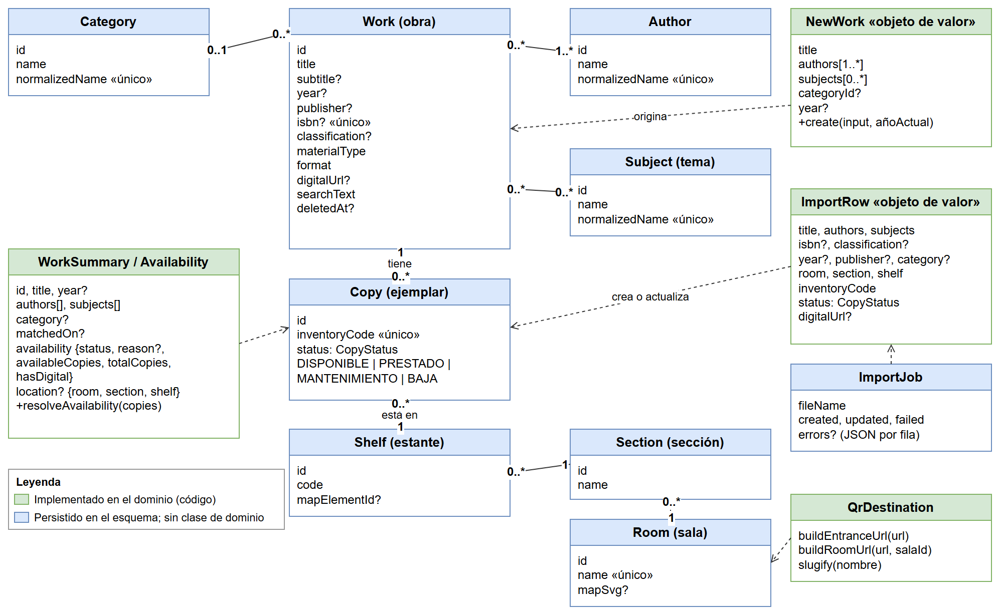
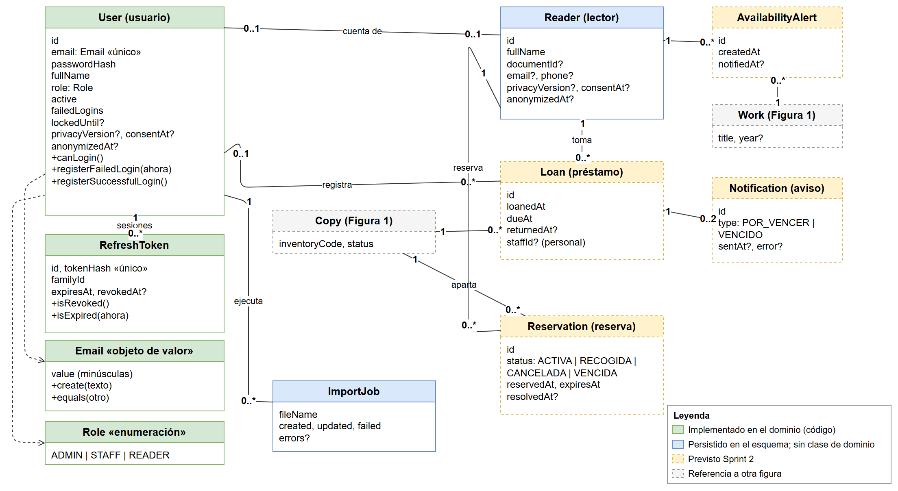
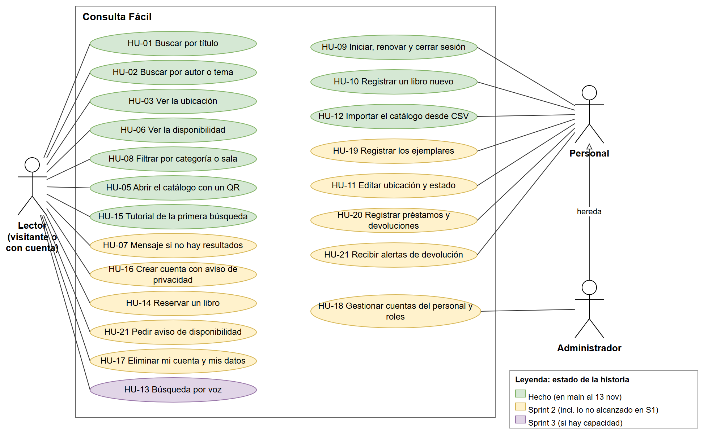

# Modelo de dominio

> Responsable: Rafael Potes · Work item: CLENA-34 (T-13). Describe los conceptos, las reglas de negocio y los casos de uso de Consulta Fácil, tal como existen en `backend/src/modules/*/domain/` y en `backend/prisma/schema.prisma` a la fecha de este documento. Las fuentes editables de los diagramas están en `docs/diagramas/` (draw.io).

## 1. Propósito y alcance

El **modelo de dominio** explica el negocio de la biblioteca con las palabras del CLENA: qué cosas existen (obras, ejemplares, lectores, préstamos), qué reglas las gobiernan y quién hace qué. No habla de tablas, endpoints ni pantallas.

Se relaciona con otros documentos así:

| Documento | Qué responde | Relación con este |
|---|---|---|
| Este documento | ¿Qué conceptos y reglas tiene el negocio? | Fuente del vocabulario y de las reglas R-01 a R-18 |
| [Modelo de datos](modelo-datos.md) | ¿Cómo se guardan en PostgreSQL? | Cada entidad de aquí corresponde a una o más tablas; los índices únicos del modelo de datos hacen cumplir varias reglas |
| [Arquitectura](arquitectura.md) | ¿Cómo se organiza el código? | Las clases con comportamiento viven en la capa `domain` de cada módulo (`iam`, `catalog`, `search`, `loans`) |
| [Backlog](backlog.md) | ¿Qué debe poder hacerse? | Las historias HU-01 a HU-21 se mapean a casos de uso en la sección 6 |

**Alcance.** Cubre todo el producto (Sprint 1, 2 y 3). Para no engañar, cada elemento se marca como:

- **Implementado en el dominio**: existe una clase o función en `domain/` con sus pruebas (`NewWork`, `ImportRow`, `User`, `Email`, `Role`, `RefreshToken`, `WorkSummary`, `WorkAvailability`, `QrDestination`).
- **Persistido en el esquema**: existe el modelo en `schema.prisma` y su migración, pero todavía no hay clase de dominio propia; su lógica vive en casos de uso y repositorios (`Work`, `Copy`, `Reader`, etc.).
- **Previsto Sprint 2**: tablas ya creadas (`Loan`, `Reservation`, `Notification`, `AvailabilityAlert`) cuyo comportamiento se implementa en el Sprint 2 (14 a 19 de noviembre).

El producto no usa inteligencia artificial y no contiene datos reales del CLENA.

## 2. Glosario

| Término | Significado en este proyecto |
|---|---|
| **Obra** (`Work`) | Un título del catálogo (libro, revista, documento, mapa u otro), con independencia de cuántas copias haya. Es lo que el lector busca. |
| **Ejemplar** (`Copy`) | Una copia física concreta de una obra, con su código de inventario y su estado. Es lo que se presta. |
| **Código de inventario** | Identificador único de un ejemplar dentro de la biblioteca. |
| **Autor** (`Author`) | Persona que escribió la obra. Una obra puede tener varios; el primero es el principal. |
| **Tema** (`Subject`) | Materia que trata la obra (por ejemplo «Historia del Caribe»). |
| **Categoría** (`Category`) | Clasificación general de la obra, una sola por obra (por ejemplo «Narrativa»). |
| **Sala** (`Room`) | Espacio físico de la biblioteca. Puede tener un plano SVG y un código QR propio. |
| **Sección** (`Section`) | División dentro de una sala. Su nombre es único dentro de la sala. |
| **Estante** (`Shelf`) | Mueble concreto de una sección donde está el ejemplar. Su código es único dentro de la sección. |
| **Ubicación** | Terna sala, sección y estante de un ejemplar. |
| **Estado del ejemplar** | `DISPONIBLE`, `PRESTADO`, `MANTENIMIENTO` o `BAJA` (retirado del inventario). |
| **Disponibilidad de la obra** | Se deriva de sus ejemplares: la obra está disponible si al menos uno está `DISPONIBLE`. Los ejemplares de baja no cuentan. |
| **Lector** (`Reader`) | Persona que toma libros prestados o reserva. Puede existir sin cuenta (registrada por el personal) o vinculada a una cuenta con rol `READER`. |
| **Visitante** | Persona que consulta el catálogo sin iniciar sesión. La búsqueda es pública. |
| **Personal** | Bibliotecarios del CLENA (rol `STAFF`): mantienen el catálogo y registran préstamos. |
| **Administrador** | Rol `ADMIN`: hace lo del personal y además gestiona las cuentas del personal y sus roles. |
| **Cuenta de usuario** (`User`) | Credenciales de acceso (correo y contraseña cifrada) con un rol. |
| **Sesión / refresh token** | Credencial de larga duración para renovar el acceso sin pedir la contraseña; se guarda solo su hash. |
| **Familia de tokens** | Conjunto de refresh tokens que nacen de un mismo inicio de sesión y se rotan entre sí. |
| **Préstamo** (`Loan`) | Entrega de un ejemplar a un lector hasta una fecha de devolución. Está activo mientras no tenga fecha de devolución real. |
| **Reserva** (`Reservation`) | Apartado de un ejemplar disponible para que un lector lo recoja antes de que venza el plazo. |
| **Alerta** | Aviso al lector. Hay dos: recordatorio de devolución de un préstamo (`Notification`) y «avísame cuando esté disponible» (`AvailabilityAlert`). |
| **Importación** (`ImportJob`) | Carga masiva del catálogo desde un archivo CSV; guarda cuántas filas se crearon, actualizaron o fallaron. |
| **Código QR** | Imagen que lleva a la URL pública del buscador: una de entrada y una por sala (esta filtra por esa sala). |
| **Texto normalizado** | Texto en minúsculas, sin tildes y con espacios colapsados; sirve para comparar nombres y para la búsqueda tolerante. |
| **Aviso de privacidad** | Texto de la Ley 1581 de 2012 que la persona acepta al crear su cuenta; se guarda la versión y la fecha. |
| **Anonimización** | Sustituir los datos personales de una cuenta por valores no identificables conservando los préstamos (HU-17). |

## 3. Entidades y objetos de valor

Los diagramas distinguen por color lo implementado en el dominio (verde), lo persistido en el esquema (azul), lo previsto para el Sprint 2 (amarillo con borde punteado) y las referencias a otra figura (gris). Una flecha punteada abierta indica dependencia («origina», «resume»); una línea con rombo relleno indica composición. Los nombres de clases se dejan en inglés porque coinciden con el código.

### 3.1 Catálogo y ubicación

*Descripción de la Figura 1.* El diagrama muestra la obra (`Work`) en el centro. A la izquierda arriba, una categoría (`Category`) se relaciona con cero o muchas obras y cada obra tiene cero o una categoría. A la derecha, la obra se relaciona de muchos a muchos con `Author` (una obra tiene uno o más autores) y con `Subject`. Debajo de la obra, cada ejemplar (`Copy`) pertenece a una obra y se ubica en un estante (`Shelf`); cada estante pertenece a una sección (`Section`) y cada sección a una sala (`Room`). Como objetos de valor, `NewWork` origina una obra al registrarla a mano e `ImportRow` crea o actualiza obras y ejemplares al importar un CSV; `ImportJob` resume el resultado de una importación. `WorkSummary` con `Availability` es la vista de lectura que usa la búsqueda y se deriva de los ejemplares. `QrDestination` calcula las URL de los QR de entrada y de cada sala.

| Elemento | Estado | Atributos principales | Reglas que lo gobiernan |
|---|---|---|---|
| `Work` (obra) | Persistido | título, subtítulo, año, editorial, ISBN, clasificación, tipo de material (`LIBRO`, `REVISTA`, `DOCUMENTO`, `MAPA`, `OTRO`), formato (`FISICO`, `DIGITAL`, `AMBOS`), URL digital, texto de búsqueda, fecha de borrado | R-05, R-06, R-11 |
| `Author`, `Subject`, `Category` | Persistido | nombre y nombre normalizado (único) | R-05 |
| `Copy` (ejemplar) | Persistido | código de inventario (único), estado, estante | R-03, R-04, R-07 |
| `Room`, `Section`, `Shelf` | Persistido | nombre o código; plano SVG opcional en la sala; identificador de elemento del plano en el estante | R-04 |
| `NewWork` | Implementado | título, autores (≥ 1), temas, categoría, año; método `create` | R-05, R-06 |
| `ImportRow` | Implementado | título, autores, temas, ISBN, clasificación, año, editorial, categoría, sala, sección, estante, código de inventario, estado, URL digital; datos inmutables | R-06, R-08 |
| `ImportJob` | Persistido | nombre del archivo, filas creadas, actualizadas y fallidas, errores por fila | R-08 |
| `WorkSummary`, `Availability`, `Location`, `WorkDetail` | Implementado | resumen de la obra con origen de la coincidencia (`title`, `author`, `subject`), disponibilidad (`DISPONIBLE` o `NO_DISPONIBLE`, motivo, ejemplares disponibles y totales, versión digital) y ubicación | R-04, R-09 |
| `QrDestination` | Implementado | funciones que arman la URL de entrada y la de una sala a partir de `PUBLIC_WEB_URL` | R-10 |

### 3.2 Acceso y circulación

*Descripción de la Figura 2.* A la izquierda, la cuenta `User` contiene un `Email` (objeto de valor) y un `Role` (enumeración `ADMIN`, `STAFF`, `READER`), y tiene cero o más `RefreshToken` (composición). Un usuario ejecuta cero o más importaciones (`ImportJob`). En el centro derecha, un `Reader` puede estar vinculado a una cuenta (relación de cero o uno a cero o uno). El lector toma cero o más préstamos (`Loan`), hace cero o más reservas (`Reservation`) y pide cero o más alertas de disponibilidad (`AvailabilityAlert`). Un préstamo y una reserva se refieren a un `Copy`, un préstamo lo registra un usuario del personal y puede generar hasta dos avisos (`Notification`: por vencer y vencido). La alerta de disponibilidad se refiere a una obra. `Copy` y `Work` se muestran en gris porque se detallan en la Figura 1.

| Elemento | Estado | Atributos principales | Reglas que lo gobiernan |
|---|---|---|---|
| `User` (usuario) | Implementado | id, correo (`Email`), hash de contraseña, nombre, rol, activo, intentos fallidos, bloqueado hasta, versión del aviso y fecha de consentimiento, fecha de anonimización; métodos `canLogin`, `isLockedAt`, `registerFailedLogin`, `registerSuccessfulLogin` | R-12, R-13, R-15, R-16 |
| `Email` | Implementado (objeto de valor) | valor en minúsculas, hasta 254 caracteres, forma `texto@dominio.ext`; compara por valor | R-12 |
| `Role` | Implementado (enumeración) | `ADMIN`, `STAFF`, `READER`; `isRole` valida un valor externo | R-14 |
| `RefreshToken` | Implementado | hash del token (único), familia, vencimiento, fecha de revocación; métodos `isRevoked` e `isExpired` | R-17 |
| `Reader` (lector) | Persistido | nombre, documento, correo, teléfono, versión del aviso y consentimiento, fecha de anonimización | R-15, R-16 |
| `Loan` (préstamo) | Previsto Sprint 2 | ejemplar, lector, personal que lo registró, fecha de préstamo, fecha límite y fecha de devolución | R-01, R-02 |
| `Reservation` (reserva) | Previsto Sprint 2 | obra, ejemplar, lector, estado (`ACTIVA`, `RECOGIDA`, `CANCELADA`, `VENCIDA`), vencimiento, fecha de resolución | R-03 |
| `Notification` (aviso de préstamo) | Previsto Sprint 2 | préstamo, tipo (`POR_VENCER`, `VENCIDO`), fecha de envío, error | R-18 |
| `AvailabilityAlert` | Previsto Sprint 2 | lector, obra, fecha de aviso | R-18 |

## 4. Reglas de negocio

La columna «Dónde se garantiza» indica el nivel que hace cumplir la regla: **dominio** (clase o función pura de `domain/`), **caso de uso** (capa `application`) o **base de datos** (restricción, índice o migración). Las reglas del Sprint 2 están previstas; las demás ya funcionan.

| ID | Regla | Dónde se garantiza | Estado |
|---|---|---|---|
| R-01 | Un ejemplar solo puede tener un préstamo activo (sin fecha de devolución). | Base de datos (índice único parcial `loans_active_copy_key`) y caso de uso de préstamos | Sprint 2 |
| R-02 | Un préstamo se conserva aunque se borre o anonimice al lector o al personal. | Base de datos (`onDelete: Restrict` hacia el lector, `SetNull` hacia el personal) | Esquema listo |
| R-03 | Un ejemplar solo puede tener una reserva activa. | Base de datos (índice único parcial `reservations_active_copy_key`) | Sprint 2 |
| R-04 | Los ejemplares dados de baja no cuentan para la disponibilidad ni para la ubicación. | Dominio (`resolveAvailability`) | Hecho |
| R-05 | No se duplican autores, temas ni categorías: dos escrituras que normalizan igual («García Márquez» y «garcia marquez») son el mismo registro. | Dominio (`NewWork` reúne repetidos y conserva la primera escritura), base de datos (único en `normalized_name`) | Hecho |
| R-06 | Una obra exige título y al menos un autor; el año es entero entre 1 y el año actual más uno; el primer autor es el principal. | Dominio (`NewWork`, `ImportRow`) | Hecho |
| R-07 | El código de inventario de un ejemplar es único. | Base de datos (único en `inventory_code`) | Hecho |
| R-08 | En una importación CSV, una fila inválida no detiene el proceso: se reporta con su número de fila y se siguen procesando las demás. Título, sala, sección, estante y código de inventario son obligatorios; la URL digital debe ser `http` o `https`; el estado debe ser uno de los cuatro válidos. | Dominio (`ImportRow`, `ImportRowError`), caso de uso de importación, `ImportJob` | Hecho |
| R-09 | La obra está disponible si al menos un ejemplar está `DISPONIBLE`. Si no, el motivo es `PRESTADO` si alguno lo está; si no `MANTENIMIENTO`; y `SIN_EJEMPLARES` si no queda ninguno. La ubicación mostrada es la del primer ejemplar disponible. | Dominio (`resolveAvailability`) | Hecho |
| R-10 | Los QR de entrada y de sala llevan solo al buscador público; la URL base debe ser `http` o `https` y la sala debe existir. | Dominio (`QrDestination`) y caso de uso | Hecho |
| R-11 | Una obra borrada lógicamente no aparece en la búsqueda pública. | Caso de uso de búsqueda (filtro `deleted_at IS NULL`), base de datos (índice) | Hecho |
| R-12 | El correo es único y siempre se guarda en minúsculas y sin espacios. | Dominio (`Email`), base de datos (único en `email`) | Hecho |
| R-13 | Tras 5 intentos fallidos de inicio de sesión la cuenta se bloquea 15 minutos y el contador vuelve a cero; un ingreso correcto reinicia los intentos. El mensaje es el mismo si falla el correo o la contraseña. | Dominio (`User`, `InvalidCredentialsError`), caso de uso de inicio de sesión | Hecho |
| R-14 | Los roles son `ADMIN`, `STAFF` y `READER`; las rutas del personal exigen sesión y rol (la importación y el registro de libros no están abiertas al lector). | Dominio (`Role`), controladores con guardas de rol | Hecho |
| R-15 | Una cuenta desactivada o anonimizada no puede iniciar sesión. | Dominio (`User.canLogin`) | Hecho |
| R-16 | Crear una cuenta de lector exige aceptar el aviso de privacidad; se guarda su versión y la fecha. Eliminar la cuenta anonimiza los datos personales y conserva los préstamos (Ley 1581 de 2012). | Caso de uso, base de datos (`privacy_version`, `consent_at`, `anonymized_at`) | Sprint 2 (HU-16 no alcanzó en el Sprint 1; HU-17 Sprint 2) |
| R-17 | El refresh token es de un solo uso: al renovar se revoca el usado y se emite uno nuevo de la misma familia. Si un token revocado reaparece, se revoca toda la familia. Solo se guarda su hash, nunca el token. | Dominio (`RefreshToken`), caso de uso `RefreshSession` y `LogoutUser`, base de datos (hash único) | Hecho |
| R-18 | Cada recordatorio es único por préstamo y tipo; solo hay una alerta de disponibilidad pendiente por lector y obra, y no se envía dos veces. | Base de datos (único `notifications(loan_id, type)` e índice parcial `availability_alerts_pending_key`) | Sprint 2 |

## 5. Actores

| Actor | Rol en el sistema | Qué puede hacer |
|---|---|---|
| **Lector** (visitante o con cuenta) | Sin rol (visitante) o `READER` | Buscar y consultar el catálogo; con cuenta, reservar, pedir avisos y eliminar su cuenta |
| **Personal** | `STAFF` | Todo lo anterior, más mantener el catálogo, importar CSV y registrar préstamos y devoluciones |
| **Administrador** | `ADMIN` | Todo lo del personal y gestionar las cuentas del personal y sus roles |

El sistema también actúa por su cuenta: la revisión diaria que envía los avisos de devolución y de disponibilidad (HU-21) corre sin intervención de una persona.

## 6. Casos de uso por actor

*Descripción de la Figura 3.* Dentro del recuadro «Consulta Fácil» se dibujan los casos de uso como óvalos, coloreados según su estado. A la izquierda, el actor Lector se conecta con 13 casos de uso: buscar por título, autor o tema, ver ubicación y disponibilidad, filtrar, abrir con QR, tutorial, mensaje sin resultados, crear cuenta, reservar, pedir aviso de disponibilidad, eliminar la cuenta y búsqueda por voz. A la derecha, el actor Personal se conecta con 7: iniciar sesión, registrar un libro, importar CSV, registrar ejemplares, editar ubicación y estado, registrar préstamos y devoluciones y recibir alertas de devolución. Abajo a la derecha, el Administrador hereda del Personal y además gestiona cuentas y roles. Verde significa hecho (integrado en `main`), amarillo Sprint 2 (incluye las historias que no alcanzaron en el Sprint 1: HU-11, HU-16, HU-18 y HU-19) y morado Sprint 3. La leyenda del diagrama tiene esos tres estados. HU-04 (interfaz legible) es transversal y aplica a todas las pantallas públicas, por eso no se dibuja como caso de uso aparte.

| Historia | Caso de uso | Actor | Estado (13 nov) |
|---|---|---|---|
| HU-01 | Buscar por parte del título, con tolerancia a errores | Lector | Hecho |
| HU-02 | Buscar por autor o tema | Lector | Hecho |
| HU-03 | Ver sala, sección y estante del libro | Lector | Hecho |
| HU-04 | Interfaz legible para adultos mayores (transversal) | Lector | Hecho |
| HU-05 | Abrir el catálogo escaneando un QR | Lector | Hecho |
| HU-06 | Ver la disponibilidad física o digital | Lector | Hecho |
| HU-07 | Mensaje claro si no hay resultados | Lector | Sprint 2 |
| HU-08 | Filtrar por categoría o sala | Lector | Hecho |
| HU-09 | Iniciar sesión, renovar y cerrar sesión | Personal y administrador | Hecho |
| HU-10 | Registrar un libro nuevo | Personal | Hecho |
| HU-11 | Editar ubicación y estado de un ejemplar | Personal | Sprint 2 (no alcanzó en el Sprint 1) |
| HU-12 | Importar el catálogo desde CSV | Personal | Hecho |
| HU-13 | Búsqueda por voz | Lector | Sprint 3 (si hay capacidad) |
| HU-14 | Reservar un libro desde la app | Lector con cuenta | Sprint 2 |
| HU-15 | Tutorial guiado de la primera búsqueda | Lector | Hecho |
| HU-16 | Crear cuenta de lector con aviso de privacidad | Lector | Sprint 2 (no alcanzó en el Sprint 1) |
| HU-17 | Eliminar mi cuenta y mis datos | Lector con cuenta | Sprint 2 |
| HU-18 | Gestionar cuentas del personal y roles | Administrador | Sprint 2 (no alcanzó en el Sprint 1) |
| HU-19 | Registrar los ejemplares de un libro | Personal | Sprint 2 (no alcanzó en el Sprint 1) |
| HU-20 | Registrar préstamos y devoluciones | Personal | Sprint 2 |
| HU-21 | Alertas de devolución y de disponibilidad | Lector y personal (envía el sistema) | Sprint 2 |

«Hecho» significa que la historia tiene su cambio integrado en `main` al 13 de noviembre de 2026; Done en el tablero oficial exige además el PR fusionado.

## 7. Referencias cruzadas con el modelo de datos

| Concepto del dominio | Tabla(s) en [Modelo de datos](modelo-datos.md) | Regla que comparten |
|---|---|---|
| Obra, autor, tema, categoría | `works`, `authors`, `subjects`, `categories`, `work_authors`, `work_subjects` | R-05, R-06, R-11 |
| Ejemplar, estante, sección, sala | `copies`, `shelves`, `sections`, `rooms` | R-04, R-07, R-09 |
| Cuenta, sesión | `users`, `refresh_tokens` | R-12, R-13, R-15, R-17 |
| Lector | `readers` | R-16 |
| Préstamo, reserva, avisos | `loans`, `reservations`, `notifications`, `availability_alerts` | R-01, R-03, R-18 |
| Importación | `import_jobs` | R-08 |

Diferencias a tener presentes: el modelo de datos habla de tablas y columnas en inglés (`copies.inventory_code`), mientras que este documento usa los términos del negocio (ejemplar, código de inventario). Las clases `WorkSummary`, `Availability` y `QrDestination` no tienen tabla: son vistas o cálculos del dominio. Cuando cambie el esquema (nueva migración), este documento se actualiza junto con el modelo de datos.
